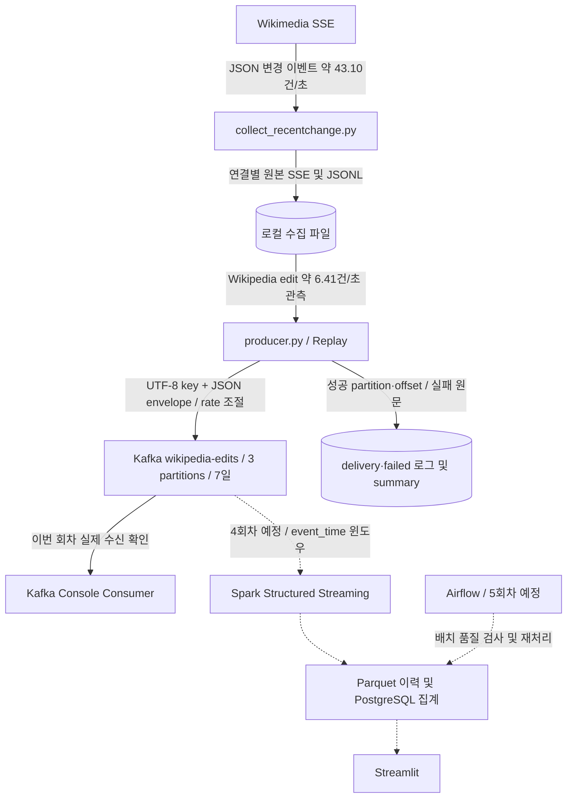

# 3주차 과제 — Wikipedia 편집 이벤트 Kafka 수집

4회차 Spark 전처리·저장 구현과 Codespaces 실행 방법은 [4회차 보고서](WEEK4.md)에 정리했다.
3회차 보고서는 [WEEK3.md](WEEK3.md)에 보관한다. 저장소 메인 화면에는 README 본문을 표시하지 않는다.

2주차의 실시간 파이프라인 설계를 바탕으로 **실제 수집 데이터 → Python Producer → Kafka → 콘솔 Consumer** 구간을 구현했다. 실시간 API를 10분간 수집한 뒤, Wikipedia 편집만 골라 재생한다. 원본을 보관하므로 같은 입력으로 전송 속도와 장애 동작을 반복 검증할 수 있다.

과제 기준은 `2회차_강의자료.pdf` 6~8쪽의 메시지·토픽 설계와 8쪽의 3회차 과제다. [이전 보고서](../docs/WEEK2.md)는 보존했으며, 제공되지 않은 발표 피드백을 임의로 작성하지 않았다.

## 1. 데이터와 실측 규모

소스: [Wikimedia EventStreams recentchange](https://stream.wikimedia.org/v2/stream/recentchange).

2026-10-25 **19:04:23~19:14:23 KST**, 600.017초 동안 수신했다. 이 API는 Wikipedia뿐 아니라 Commons·Wikidata 등의 변경도 전달한다. Kafka에 보내는 범위는 `server_name.endswith('.wikipedia.org') AND type == 'edit'`다. 새 문서·분류 변경·로그는 제외한다.

| 항목 | 실측 |
|---|---:|
| 전체 Wikimedia 변경 이벤트 | 25,860건 / 43.10건·초 |
| Wikipedia 전체 변경 | 8,039건 |
| **Kafka 전송 대상 Wikipedia 편집** | **3,846건 / 6.41건·초** |
| 전체 원본 JSONL / gzip | 36.80MB / 5.17MB |
| Wikipedia 편집 원본 JSONL 바이트 합계 | 4.57MB |
| Kafka 정규화 value 평균 | 약 1,430바이트 |
| Kafka key 평균 | 약 36바이트 |

[수집 결과](../docs/RESULT.md), [원본 집계](../evidence/collection_summary.json), [용량 추정 계산값](../evidence/capacity_estimate.json).

10분 표본의 편집 빈도가 유지된다고 **가정**하면 하루 약 55.4만 건, key+value 약 **0.81GB/일**, 7일 약 **5.68GB**다. 이는 짧은 표본의 선형 추정이다. Kafka 레코드·인덱스·세그먼트 오버헤드와 복제본은 제외했고 LZ4 압축 효과도 적용하지 않았다. 실제 디스크 용량 측정값과는 다르다. GB는 10억 바이트 기준이다.

관측 구간은 수신 시간 기준이다. 과거 `timestamp`를 가진 로그도 실시간으로 전달될 수 있으므로 이벤트 시각의 최솟값을 수집 시작 시각으로 해석하지 않는다. 이번 Kafka 대상에는 `edit`만 포함하며 `event_time`을 원본 `timestamp`에서 변환한다.

## 2. 전체 구조와 이번 구현 범위



실선은 구현 범위, 점선은 후속 회차 설계다. 2주차의 수집·재생·처리 분리를 유지하면서 실제 메시지 계약과 토픽 설정을 구체화했다. `--rate`는 6회차 부하 테스트 준비 기능이며, 이번 실행 결과를 최대 처리 성능으로 해석하지 않는다.

## 3. Topic 구성과 결정 이유

| 항목 | 결정 | 이유와 한계 |
|---|---|---|
| 토픽 | `wikipedia-edits` 1개 | 편집만 동일 스키마·소비자로 처리하므로 언어별 토픽을 나누지 않음 |
| 파티션 | 3개 | 로컬 병렬 소비와 후속 부하 테스트 비교 기준. 현재 6.41건/초 때문에 3개가 필수인 것은 아님 |
| key | `wiki:title` | 같은 위키의 같은 문서를 같은 파티션으로 보내 순서를 유지. 인기 문서 편중 및 문서 이동에 따른 key 변경 가능 |
| 리텐션 | `604800000`ms = 7일 | 일주일 내 재소비·실험 지원. 예상 용량 약 5.68GB + 오버헤드, 시간 기반 삭제는 세그먼트 단위로 지연 가능 |
| 정리 정책 | `cleanup.policy=delete` | 편집 이력을 보존하므로 최신 key만 남기는 compaction을 사용하지 않음 |
| 복제 계수 / 최소 ISR | 1 / 1 | 로컬 단일 브로커 실습. 브로커·디스크 장애에 대한 고가용성은 제공하지 않음 |

같은 key의 **Kafka 기록 순서**를 보장하는 것이며 늦게 도착한 이벤트의 발생 시각까지 정렬해 주지는 않는다. 파티션 수를 바꾸면 key의 파티션 배치가 바뀔 수 있다. 파티션 3개인 이 토픽에 대해 한 Consumer Group이 동시에 활용하는 소비 병렬성은 최대 3개다.

Kafka의 대안은 파일 직접 읽기다. 현재 규모는 파일만으로도 처리할 수 있지만 이번 프로젝트는 생산·소비 분리, offset 기반 재소비, 장애 및 부하 실습이 목적이므로 Kafka를 선택했다. 대신 브로커 운영·로컬 자원 사용·중복 처리 설계 부담을 받아들인다.

## 4. Producer 흐름과 메시지 계약

1. JSONL을 한 줄씩 읽고 canary와 Wikipedia 편집 외 이벤트를 제외한다.
2. 필수 필드를 확인하고 key 및 공통 envelope를 만든다.
3. 한 실행 내 `event_id` 중복을 제외하고 `--rate`에 따라 전송 간격을 조절한다.
4. JSON을 UTF-8로 직렬화해 `produce(topic, key, value, on_delivery=...)`에 전달한다.
5. `poll()`로 콜백을 처리하고 종료 시 `flush()`로 남은 전송을 기다린다.
6. 성공은 partition·offset, 실패는 원문과 사유를 기록한다. 실패·미확정 전송·잘못된 입력·0건 전송은 종료 코드 1로 알린다.

| 필드 | 정의 |
|---|---|
| `event_id` | 원본 `meta.id` 우선. 없으면 `wiki:edit:id`; 둘 다 없으면 실패 |
| `event_type` | `wikipedia.edit` |
| `event_time` | 원본 `timestamp`를 UTC ISO 8601로 변환 |
| `ingest_time` | Producer가 이번 전송 직전에 기록한 UTC 시각 |
| `schema_version` | `1` |
| `source` | `wikimedia-recentchange-replay` |
| `payload` | 원본 Wikimedia 이벤트 전체 |

Replay에서도 event_id와 event_time은 유지한다. 따라서 `현재 시각 - event_time`은 저장 후 재생 대기 시간까지 포함하며 처리 성능 지표가 아니다. 후속 부하 테스트의 파이프라인 지연은 `processed_time - ingest_time`으로 별도 측정하고, 원본 이벤트 시간 집계와 구분한다.

실제로 소비한 key와 JSON 예시는 [소비 캡처](../evidence/consumer_sample.txt), 읽기 편한 전체 JSON은 [메시지 예시](../evidence/message_example.json)에 보관한다. payload를 포함한 원문은 가상 예시가 아니다. 아래는 그 메시지의 공통 필드 발췌이며 payload는 링크에서 확인할 수 있다.

```json
{
  "key": "arwiki:أكاديمية تشولاتشومكلاو العسكرية الملكية",
  "event_id": "eeda7480-d5f5-4cd8-9a9e-8965a8d62143",
  "event_type": "wikipedia.edit",
  "event_time": "2026-10-25T10:04:24+00:00",
  "ingest_time": "2026-10-25T10:27:53.047946+00:00",
  "schema_version": 1,
  "source": "wikimedia-recentchange-replay"
}
```

### 안정성 설정

- `enable.idempotence=true`, `acks=all`: 같은 Producer 세션의 내부 재전송 중복을 방지하고 현재 ISR의 응답을 기다린다. RF=1인 실습에서는 응답을 주는 복제본도 하나다.
- `delivery.timeout.ms=120000`: 일시 장애의 재시도는 Kafka 클라이언트에 맡기고, 기한 초과는 실패 콜백으로 기록한다.
- `compression.type=lz4`: 배치 압축. 전체 JSONL gzip 측정값과 Kafka LZ4 압축률은 다르다.
- 로컬 큐가 가득 차면 `poll()`로 비우며 제한 시간까지만 재시도한다.
- 영구 실패는 `failed.jsonl`에 남겨 원인 해결 후 원본 파일로 다시 재생한다. 실패 이벤트를 무한 재시도하지 않는다.

**전체 파이프라인 exactly-once를 주장하지 않는다.** Producer 재실행·중복 파일·결과 불확실한 전송에는 다시 기록될 수 있다. 후속 소비자는 `event_id`로 중복 제거 및 멱등 저장해야 한다. 이번 Producer의 메모리 set은 한 번 실행 중의 중복만 제거한다.

## 5. 재현 방법

필요 환경: Docker Desktop(실행 상태), Docker Compose, Python과 pip. 검증 환경은 Python 3.14 / ARM64 macOS이며 클라이언트 버전은 requirements.txt로 고정했다.

```bash
python3 -m venv .venv
source .venv/bin/activate
pip install -r requirements.txt

docker compose up -d --wait

docker compose exec -T kafka /opt/kafka/bin/kafka-topics.sh \
  --bootstrap-server localhost:29092 --create --if-not-exists \
  --topic wikipedia-edits --partitions 3 --replication-factor 1 \
  --config retention.ms=604800000 --config cleanup.policy=delete \
  --config min.insync.replicas=1

docker compose exec -T kafka /opt/kafka/bin/kafka-topics.sh \
  --bootstrap-server localhost:29092 --describe --topic wikipedia-edits
```

브로커가 healthy가 된 뒤 전송한다. 호스트 Python은 `localhost:9092`, 같은 Compose 네트워크의 컨테이너는 `kafka:29092`로 접속한다. 호스트 포트는 로컬 루프백에만 열었다. 기존 토픽이 있으면 `--if-not-exists`는 설정을 변경하지 않으므로 describe 결과를 확인한다.

전체 수집 파일이 있는 현재 폴더에서는:

```bash
python -m src.producer --input data/20261025T100423_674945Z/events.jsonl --rate 200
```

원본 대용량 파일을 Git에 넣지 않아도 포함된 20건 샘플로 재현할 수 있다:

```bash
python -m src.producer --input samples/wikipedia_edits.jsonl --rate 10
```

콘솔 consumer로 실제 key와 JSON을 확인한다:

```bash
docker compose exec -T kafka /opt/kafka/bin/kafka-console-consumer.sh \
  --bootstrap-server localhost:29092 --topic wikipedia-edits \
  --from-beginning --max-messages 20 --timeout-ms 30000 \
  --property print.key=true
```

기존 토픽을 다시 읽으면 이전 실행 메시지도 보인다. 깨끗한 반복 검증에는 새 토픽을 만들고 `python -m src.producer --topic 새토픽`을 사용한다. `--rate 0`은 제한 없이 전송, `--limit 100`은 필터 후 100건만 전송한다. rate는 목표 전송 상한이며 실제 ACK 속도나 브로커의 최대 성능이 아니다.

```bash
python -m unittest discover -s tests -v
# 데이터는 유지하고 과제 컨테이너만 중지
docker compose stop
# 같은 볼륨으로 다시 시작
docker compose up -d --wait
```

10분 수집을 다시 할 때는 [수집 실행 안내](../docs/COLLECTION.md)를 따른다. 새 수집 경로를 Producer의 `--input`으로 전달한다.

## 6. 제출 파일과 검증 증거

### 실제 Kafka 검증 결과

2026-10-25 **19:27:52~19:28:12 KST** 실행, `--rate 200`으로 19.23초 동안 전송했다. 목표 속도로 재생한 결과이며 Kafka의 최대 처리량 측정은 아니다.

| 검증 항목 | 결과 |
|---|---:|
| 입력 / 필터 제외 | 25,860 / 22,014건 |
| 전송 큐 등록 / 성공 콜백 | 3,846 / 3,846건 |
| 실패 / 미확정 / 잘못된 입력 | 모두 0건 |
| 콘솔 Consumer 수신 | 3,846건 |
| event_id 중복 / 누락 | 모두 0건 |
| 파티션 0 / 1 / 2 | 1,328 / 1,266 / 1,252건 |
| ACK 기준 평균 완료량 | 약 200.02건/초 |
| 오프라인 테스트 | 7개 통과 |

근거: [토픽 describe](../evidence/topic_describe.txt), [Producer 요약](../evidence/producer_summary.json), [성공 콜백 예시](../evidence/delivery_sample.jsonl), [콘솔 처리 건수](../evidence/consumer_stderr.log), [원본 대조 결과](../evidence/verification.json).

`verify_delivery.py`로 예상 event_id 전체 집합, key, payload, 공통 필드, 중복 여부, ACK partition·offset 유일성을 대조했다. 전체 콘솔 출력은 로컬 `artifacts/consumer_full.txt`에 있고, 제출 자료에는 세 메시지의 원문 캡처와 전체 출력의 SHA-256을 포함한다.

```bash
python -m src.verify_delivery \
  --input data/20261025T100423_674945Z/events.jsonl \
  --consumed artifacts/consumer_full.txt \
  --run artifacts/runs/20261025T102752_972357Z
```

처음 Docker 기동 시 기존 컨테이너들의 자원 경합으로 브로커 준비가 늦어져 첫 전송은 3,846건 모두 시간 초과했다. 이 실행은 [별도의 실패 요약](../evidence/startup_failure_summary.json)과 [실패 원문 예시](../evidence/startup_failure_sample.json)에 남겼으며 성공 결과에 합치지 않았다. 정상 실행도 초기 IPv6 접속 실패·Coordinator 초기화 경고가 있었지만 클라이언트가 재시도해 전부 성공했다. [클라이언트 로그](../evidence/producer_stderr.log)를 함께 보관한다.

검증 후 로컬 자원 사용을 줄이기 위해 이번 Kafka 컨테이너는 중지한다. 토픽 데이터는 Docker volume에 유지되며 `docker compose up -d --wait`로 다시 실행할 수 있다.

### 파일 구성

```text
3week_homework/
├── docs/WEEK3.md              # 3회차 과제 보고서 (메인 화면 노출 제외)
├── docker-compose.yml         # Kafka 실행 설정
├── requirements.txt           # Python 의존성
├── src/                       # 실제 실행 코드
│   ├── __init__.py
│   ├── collect_recentchange.py # SSE 수집·규모 측정
│   ├── producer.py            # Kafka 전송 및 속도 조절
│   └── verify_delivery.py     # 수신 데이터와 원본 대조
├── tests/                     # 단위 테스트
│   ├── __init__.py
│   ├── test_collect_recentchange.py
│   └── test_producer.py
├── docs/                      # 이전 과제·수집 안내·수집 결과
├── samples/                   # 재현용 소규모 입력 데이터
├── evidence/                  # 제출용 검증 결과·메시지 캡처
├── data/                      # 전체 수집 데이터 (Git 제외)
├── artifacts/                 # 실행 로그·전체 소비 결과 (Git 제외)
└── dist/                      # 제출용 ZIP (Git 제외)
```

**모든 명령은 프로젝트 최상위 폴더에서 실행한다.** 소스는 `python -m src.모듈명`으로 실행하며, 테스트는 `python -m unittest discover -s tests -v`로 실행한다. `evidence/`는 보고서 근거로 남길 결과이고, `artifacts/`는 실행 과정에서 생성되는 로컬 작업 파일이다. 이전 실행의 JSON 기록에 있는 경로와 시각은 당시 증거이므로 유지했다.


- `src/producer.py`: 과제 핵심 코드, 속도 조절 보너스 포함.
- `docker-compose.yml`, `requirements.txt`: 로컬 실행 환경.
- `samples/wikipedia_edits.jsonl`: 실제 수집 데이터에서 고른 재현용 20건.
- `evidence/`: 토픽 설정·Producer 요약·실제 소비 캡처·검증 결과.
- `tests/test_producer.py`, `tests/test_collect_recentchange.py`: 오프라인 테스트.
- `src/collect_recentchange.py`, `docs/RESULT.md`, `docs/COLLECTION.md`: 선행 수집 코드와 측정 근거.
- `docs/WEEK2.md`: 이전 설계 보고서.

Git에 올릴 때 `.venv/`, 대용량 `data/`, 실행별 전체 로그 `artifacts/`, 제출 압축본 `dist/`는 제외한다. 강의 PDF의 제출 형식은 **레포 링크(producer.py) + README 업데이트**, 마감은 **10/26 월요일 20:00 전**이다. 이 작업은 로컬 구현·검증과 제출 자료 준비까지이며 원격 레포 생성이나 디스코드 전송은 포함하지 않는다.

## 7. 참고 자료

- 사용자 제공 `2회차_강의자료.pdf`, 6~8쪽: Topic·메시지·Producer 설정, 과제 범위.
- [Wikimedia EventStreams 설명](https://wikitech.wikimedia.org/wiki/Event_Platform/EventStreams_HTTP_Service)
- [Apache Kafka Docker 안내](https://kafka.apache.org/38/getting-started/docker/)
- [Confluent Python Client: 전송 콜백·poll·flush](https://docs.confluent.io/kafka-clients/python/current/overview.html)
