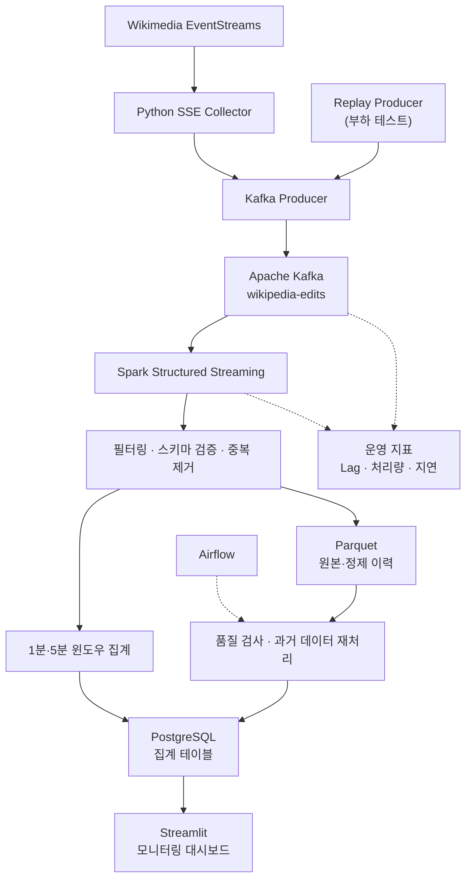

# Wikipedia 실시간 편집 이벤트 데이터 파이프라인 설계

> **목표:** Wikipedia 편집 이벤트를 실시간 수집·집계하고, 재처리 및 부하 테스트가 가능한 파이프라인 설계

## 1. 사용 데이터 설명

### 1.1 데이터 개요

| 항목 | 내용 |
|---|---|
| 데이터 소스 | [Wikimedia EventStreams – Recent Changes](https://stream.wikimedia.org/v2/stream/recentchange) |
| 데이터 형식 | JSON 이벤트 (SSE: Server-Sent Events) |
| 수집 대상 | Wikipedia 문서 편집 이벤트 (`type=edit` 중심) |
| 발생 특성 | 사용자·봇의 편집에 따라 비정기적으로 실시간 발생 |
| 이벤트 발생량·크기 | **실제 샘플 수집 후 측정 예정** (events/sec, 평균 bytes/event) |
| 활용 목적 | 위키별 편집량, 봇 비율, 문서별 편집 급증 및 처리 지연 모니터링 |

### 1.2 주요 필드

| 필드 | 설명 |
|---|---|
| `id`, `wiki` | 이벤트 식별 및 위키 구분 (중복 제거 키 설계 시 함께 고려) |
| `timestamp` | 편집 이벤트 발생 시각 (Unix timestamp) |
| `title`, `user` | 편집 문서와 사용자 |
| `bot`, `type` | 봇 여부, 변경 유형 |
| `length.old`, `length.new` | 편집 전후 문서 길이 |

**처리 후 이벤트 예시** (원본 응답이 아닌 정규화 형태를 보여주는 가상 샘플):

```json
{
  "event_id": "enwiki:edit:123456789",
  "event_time": "2026-10-21T10:30:00Z",
  "wiki": "enwiki",
  "title": "Apache Kafka",
  "bot": false,
  "type": "edit"
}
```

## 2. 전체 파이프라인 구조도



- **실시간 흐름(실선):** SSE 수집 → Kafka → Spark 전처리·집계 → PostgreSQL → 대시보드.
- **이력·복구:** Parquet에 이벤트를 보관하고, Airflow가 품질 검사와 재처리 작업을 실행.
- **성능 검증:** Replay Producer로 이벤트 입력 속도를 조절하여 처리량·지연·복구 동작 측정.
- **점선:** 데이터 본류가 아닌 스케줄링·모니터링 관계.

## 3. 플랫폼 선정 이유

| 기술 | 선정 이유 | 대안 대비 판단 |
|---|---|---|
| **Kafka** | 수집과 처리를 분리하고 이벤트 보관·재소비·부하 테스트 지원 | 직접 전달 방식보다 장애 및 처리량 변동에 대응하기 용이 |
| **Spark Structured Streaming** | 이벤트 시간 기준 윈도우 집계, 중복 제거, 체크포인트 기반 복구 | 단순 Python/Pandas 처리보다 상태 기반 스트리밍에 적합 |
| **Airflow** | 정기 품질 검사와 과거 데이터 재처리 작업의 의존성·재시도 관리 | cron보다 실행 이력 및 작업 관리에 유리 |
| **PostgreSQL** | 집계 결과를 SQL로 조회하고 고유 키 기반 Upsert 적용 | 대시보드용 관계형 집계 데이터에 적합 |
| **Parquet** | 원본·정제 이벤트 이력의 압축 저장 및 재처리 | CSV보다 분석용 컬럼 읽기에 효율적 |

**설계 핵심:** 이벤트 식별자를 기준으로 중복을 관리하고, 이벤트 발생 시각으로 집계하며, Kafka 재소비·Parquet 재처리·Replay 테스트를 통해 안정성을 검증한다.
