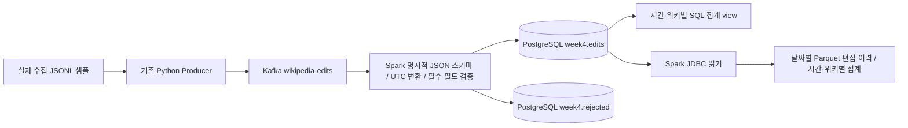

# 4회차 과제: Spark 전처리와 저장

## 범위와 현재 검증 상태

3회차의 Wikimedia 편집 메시지를 Kafka에서 읽고, Spark Structured Streaming으로
검증·형 변환한 뒤 PostgreSQL에 저장한다. PostgreSQL의 정상 편집 이력을 Parquet으로
내보내며 UTC 시간·위키별 집계도 만든다.

**현재는 구현과 정적 검사를 완료한 상태다. Codespaces 통합 실행 결과는 아직 확보하지 않았다.**
아래 `demo`와 `verify`가 성공하면 실제 결과 파일이 생성된다. 3회차의 3,846건 전송 기록을
4회차 실행 결과로 사용하지 않는다. 실제 실행 결과와 남은 오류는 생성된 보고서를 기준으로 갱신한다.

## 1. 처리 흐름



- 입력: Kafka `wikipedia-edits`, UTF-8 key와 JSON envelope. 새 checkpoint에서는 earliest부터 읽는다.
- 전처리: `src/process_edits.py`의 `transform`. 원본은 3회차 JSONL과 Kafka에 보존한다.
- 저장: micro-batch마다 정상·오류 레코드를 하나의 PostgreSQL transaction으로 저장한다.
- 중복: `event_id` 기본 키에 `ON CONFLICT DO NOTHING`을 적용한다. 같은 ID는 처음 커밋된 값을 유지한다.
- 집계: `event_time` 기준 UTC 시간과 wiki별 편집 수·봇 편집 수·편집 크기 증감을 계산한다.
- 파일 출력: 기본 실행은 시작 시 확보된 Kafka 입력을 처리하고 종료하는 `availableNow` 방식이다.
  정상 종료 후 DB를 읽어 Parquet snapshot을 만든다.

Kafka를 쓰는 이유와 3회차 전송 확인은 [3회차 보고서](WEEK3.md),
[상세 README](README_DETAILED.md)에 있다. 이번 회차는 Spark를 컨테이너의 `local[2]`로 실행한다.
분산 클러스터의 성능이나 고가용성을 검증하는 작업은 아니다.

## 2. Codespaces 실행 방법

Codespaces 프로젝트 루트의 bash 터미널에서 실행한다. 로컬 PC의 Java·Spark·Docker Desktop은 필요 없다.
Codespaces Docker는 실행 중이어야 한다. `docker-compose.yml`은 기존 Kafka 설정을 유지하고,
`compose.week4.yml`로 PostgreSQL과 Spark만 추가한다.

```bash
git pull --ff-only origin master
source .venv/bin/activate
# 3회차 패키지를 아직 설치하지 않았다면:
pip install -r requirements.txt

# 이미지 빌드, DB 준비, 실제 수집 샘플 20건 전송, Spark 처리, DB·Parquet 대조
bash scripts/week4.sh demo
```

처음에는 Spark 이미지와 Maven Kafka/JDBC 패키지를 내려받는다. 1GB Spark driver와 로컬 2개
작업 스레드를 사용한다. 메모리가 부족하면 Codespace 자원을 확인하고 다른 작업을 중지한다.
PostgreSQL은 호스트 포트를 공개하지 않는다. Compose 내부의 `postgres:5432`로 접근한다.
기본 DB 비밀번호는 이 과제용 로컬 개발값이며, 외부 서비스용 인증 정보로 재사용하지 않는다.

정상 실행 시 확인할 파일:

| 위치 | 의미 |
|---|---|
| `evidence/week4/demo_verification.json` | DB·Parquet 건수, 중복 여부, 집계 합계, 처리 후 예시 |
| `artifacts/week4/checkpoints/main/` | Kafka 처리 진행 위치 |
| `artifacts/week4/parquet/CURRENT.json` | 마지막으로 완료된 Parquet snapshot 경로 |
| `artifacts/week4/parquet/snapshots/<실행ID>/edits/` | 날짜별 정상 편집 이력 |
| `artifacts/week4/parquet/snapshots/<실행ID>/hourly_wiki/` | UTC 시간·위키별 집계 |

`artifacts/`는 Git에서 제외한다. `evidence/week4/`에는 검증 성공 후 생성되는 작은 보고서를 보관한다.
전체 데이터의 검증 결과를 얻으려면 원본 JSONL을 Codespaces로 가져오거나
[수집 안내](COLLECTION.md)에 따라 다시 수집한 후 아래처럼 전송한다.

```bash
python -m src.producer --input data/실제수집폴더/events.jsonl --rate 200
bash scripts/week4.sh run
bash scripts/week4.sh check --report evidence/week4/full_verification.json
```

샘플만 처리했다면 이를 전체 3,846건 처리로 보고하지 않는다.

## 3. 전처리 규칙과 이유

| 대상 | 처리 | 이유 |
|---|---|---|
| JSON·숫자·boolean | `StructType`으로 명시적 해석, 손상·타입 불일치는 오류로 분리 | 암묵적인 타입 추론 방지 |
| `schema_version` | 버전 1만 허용 | 미구현 버전을 정상 데이터로 처리하지 않음 |
| `event_time`, `ingest_time` | 명시적 timezone이 있는 시각만 허용하고 UTC로 변환 | 발생 시각과 전송 시각을 구분 |
| 필수 필드 | ID·source·wiki·title·bot·시각을 검증 | 불완전한 행을 집계에서 제외 |
| 이벤트 범위 | Wikipedia 도메인과 `payload.type=edit` 확인 | 3회차 토픽 계약 유지 |
| Kafka key | `wiki:title`과 일치하는지 확인 | 문서 단위 key 계약 검증 |
| `length.old/new` | 없으면 NULL 유지, 음수 길이는 오류 | 모르는 길이를 0으로 만들지 않음 |
| `bytes_delta` | `new_length - old_length` | 삭제 편집은 정상적인 음수 변화량 |
| 중복 | PostgreSQL `event_id` PK, 최초 커밋 값 유지 | 실행 간·batch 간 중복 제거 |

과거에 발생한 편집도 입력으로 허용한다. 오래된 수집 파일을 재생하는 과제이므로 watermark로
과거 이벤트를 버리지 않는다. 집계는 canonical DB에서 계산해 지연 도착한 행도 반영한다.
같은 ID의 수정 이력을 갱신하는 정책은 구현하지 않았으며, ID별 최초 입력 유지가 현재 계약이다.

## 4. 입력·출력 예시

실제 처리 전 메시지: [3회차 메시지 원문](../evidence/submission_message.json).
실제 처리 후 예시는 `demo`가 만드는 `evidence/week4/demo_verification.json`의 `output_examples`에 기록된다.

아래는 **합성 테스트 fixture의 예상 변환**이며 실제 Wikimedia 실행 결과로 제시하지 않는다.

```json
{
  "event_id": "week4-test-a",
  "event_time": "2026-10-25T19:04:24+09:00",
  "ingest_time": "2026-10-25T10:05:00Z",
  "payload": {
    "wiki": "kowiki", "title": "테스트 문서", "bot": false,
    "length": {"old": 100, "new": 130}
  }
}
```

| 출력 필드 | 예상 값 |
|---|---|
| event_id | week4-test-a |
| event_time | 2026-10-25 10:04:24+00:00 |
| ingest_time | 2026-10-25 10:05:00+00:00 |
| wiki / title / bot | kowiki / 테스트 문서 / false |
| old_length / new_length / bytes_delta | 100 / 130 / 30 |

## 5. 최종 스키마

DDL: [sql/week4.sql](../sql/week4.sql).

### 정상 이력 `week4.edits`

| 필드 | PostgreSQL 자료형 | 의미 |
|---|---|---|
| event_id | TEXT PRIMARY KEY | 원본의 안정적인 이벤트 식별자, 중복 판단 기준 |
| event_type | TEXT NOT NULL | wikipedia.edit |
| schema_version | INTEGER NOT NULL | 메시지 버전, 현재 1 |
| event_time | TIMESTAMPTZ NOT NULL | 실제 편집 발생 시각 |
| ingest_time | TIMESTAMPTZ NOT NULL | Producer 전송 직전 시각 |
| source | TEXT NOT NULL | 입력 출처 |
| wiki | TEXT NOT NULL | 위키 식별자 |
| title | TEXT NOT NULL | 편집 문서명 |
| bot | BOOLEAN NOT NULL | 봇 편집 여부 |
| old_length / new_length | BIGINT NULL | 변경 전·후 바이트 수, 미제공 시 NULL |
| bytes_delta | BIGINT NULL | 편집 크기 증감 |
| source_topic | TEXT NOT NULL | 처음 저장된 Kafka 토픽 |
| source_partition | INTEGER NOT NULL | 처음 저장된 파티션 |
| source_offset | BIGINT NOT NULL | 처음 저장된 offset |
| processed_at | TIMESTAMPTZ NOT NULL | 최초 DB 저장 시각 |

Parquet은 동일 필드와 `event_date` DATE 파티션을 포함한다. 시각은 Spark UTC timestamp로 저장한다.

### 오류 `week4.rejected`

`source_id` TEXT PK는 `[topic,partition,offset]` 조합이며 같은 Kafka 레코드를 재처리해도 중복 저장하지 않는다.
`source_topic` TEXT, `source_partition` INTEGER, `source_offset` BIGINT,
`raw_value` TEXT, `error_reason` TEXT, `rejected_at` TIMESTAMPTZ를 저장한다.
같은 오류 내용을 새 offset으로 재전송하면 서로 다른 오류 수신 기록으로 남긴다.

### 집계 `week4.hourly_wiki`

`hour_utc` TIMESTAMP WITHOUT TIME ZONE(UTC), `wiki` TEXT,
`edit_count` BIGINT, `bot_edit_count` BIGINT,
`size_known_count` BIGINT, `net_bytes_delta` NUMERIC.
DB에서는 유일한 편집 이력을 집계하는 view로 제공한다. NULL 변화량은 합계에서 제외하며,
모두 NULL인 그룹의 합계는 NULL로 유지한다. Parquet 집계는 Spark의 `sum(long)`이므로
`net_bytes_delta`가 BIGINT이며, 과제 규모에 맞춘다.

## 6. 저장 포맷 선택과 복구

- **PostgreSQL:** ID 유일성·transaction·SQL 조회가 필요하다. 집계는 이 테이블에서 계산하므로
  동일 편집을 다시 받아도 편집 수를 추가하지 않는다.
- **Parquet:** 컬럼 단위 분석·압축·Spark 재처리에 적합하다. DB의 정상 이력을 날짜별로 내보낸다.
  `CURRENT.json`에 기록된 **한 snapshot만** 읽는다. snapshots 전체를 한꺼번에 읽으면 같은 이력이 중복된다.
- 두 저장소에 동시 커밋하는 분산 transaction은 사용하지 않는다. DB를 기준으로 Parquet을 다시 만들 수 있다.
  DB 저장 후 파일 export가 실패하면 `bash scripts/week4.sh run --export-only`로 재시도한다.
- Parquet은 새 경로에 모두 쓴 뒤 `CURRENT.json`을 원자적으로 교체한다. 중단된 snapshot은
  manifest에 게시되지 않는다. 파일 export는 한 작업씩 실행하며 snapshot 보존·삭제 자동화는 후속 범위다.

실패 시 동작:

| 실패 시점 | 재시작 동작 |
|---|---|
| DB transaction 완료 전 | DB rollback, checkpoint 미완료 batch 다시 처리 |
| DB commit 후 Spark checkpoint 완료 전 | 같은 batch 재처리, PK 충돌 행은 건너뜀 |
| checkpoint 완료 후 | 저장된 offset 다음부터 읽음 |
| 같은 원본을 Producer가 다시 전송 | 새 Kafka offset이어도 event_id가 같으면 최종 정상 행 수 유지 |
| Parquet export 도중 | 기존 CURRENT 유지, DB에서 다시 export |

checkpoint를 지우면 Kafka를 처음부터 읽을 수 있다. DB PK는 중복을 막지만 checkpoint와 DB·Kafka
볼륨은 함께 보존한다. `failOnDataLoss=true`이므로 보관 기간 경과·토픽 재생성으로 offset이 사라지면
실패로 알린다. 오류를 무시하고 자동으로 건너뛰지 않는다.

기본 실행은 유한 입력 검증용이다. 계속 수신하려면:

```bash
bash scripts/week4.sh run --continuous
```

연속 실행 중 DB는 갱신되지만 Parquet snapshot은 주기적으로 생성하지 않는다. 정상 종료 뒤 또는
별도 `--export-only` 실행으로 내보낸다. 한 topic/checkpoint/DB 조합에 Spark writer 하나만 실행한다.

## 7. 자동 검증

```bash
bash scripts/week4.sh verify
```

별도 테스트 DB와 토픽을 생성하고 실제 데이터 DB에는 합성 레코드를 넣지 않는다.
테스트 fixture는 총 7개: 정상 발생 4개(고유 ID 3개), 잘못된 JSON·시각 누락·미지원 버전 각 1개다.

| 검사 | 성공 기준 |
|---|---|
| Spark 변환 | 시간대 변환, NULL 보존, 음수 변화량, 필드 타입·버전·key 오류 분리 |
| commit 후 강제 실패 → 복구 | 정상 이력 3행, 오류 3행 |
| 같은 checkpoint로 재시작 | 정상 3행, 오류 3행 유지 |
| 원본 7개를 새 offset으로 재전송 | 정상 3행 유지, 오류는 새 수신 3건을 더해 6행 |
| 집계 | 편집 수 3, 봇 수 1, 길이 제공 2, 전체 변화량 10 |
| Parquet | DB 정상 행 수·고유 ID 수·집계 편집 수와 일치 |

성공 시 `evidence/week4/recovery_verification.json`이 생성된다. 전체 로그는
`artifacts/week4/tests/<실행ID>/`에 남긴다. 스크립트가 실패하면 PASS로 보고하지 말고 해당 로그를 확인한다.
테스트 DB·토픽은 실패 분석을 위해 자동 삭제하지 않으며 반복 실행 시 새 이름을 쓴다.

검증 완료 후 보고서를 Git에 반영:

```bash
git add evidence/week4/
git commit -m "Record week 4 Codespaces verification"
git push origin master
```

데이터를 보존하며 이번 작업 서비스를 중지:

```bash
docker compose -f docker-compose.yml -f compose.week4.yml stop
```

Codespaces도 작업 후 Stop한다. `down -v`는 DB·Kafka 볼륨을 삭제하므로 재시작 검증에 사용하지 않는다.

## 8. 남은 범위와 참고

- Codespaces에서 `demo`와 `verify` 실행 후 실제 증거와 오류 여부를 기록해야 한다.
- 실행 검증은 단일 writer·소규모 학습 데이터 대상이다. DB 드라이버 단일 transaction으로 적재하며,
  대규모 분산 적재·여러 동시 writer·스키마 migration·집계 materialization은 후속 범위다.
- PostgreSQL view와 Parquet snapshot은 실시간으로 동기화된 한 transaction이 아니다.
- 이번 회차에는 대시보드와 Airflow를 추가하지 않는다.
- 근거: 사용자 제공 `3회차_강의자료.pdf` 11~12쪽(처리 흐름, 전후 예시, 스키마, 저장 포맷, 재실행).
- [Spark 3.5.8 Kafka 연동](https://spark.apache.org/docs/3.5.8/structured-streaming-kafka-integration.html)
- [Spark foreachBatch와 checkpoint](https://spark.apache.org/docs/3.5.8/structured-streaming-programming-guide.html)
