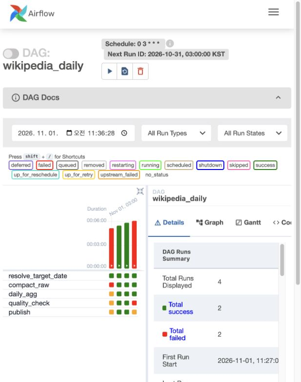

# 5회차 Airflow 발표 대본

발표 5분 + 피드백 3분. 아래 대본을 기준으로 설명하며, 표와 코드 링크는 질문을 받을 때 참고한다.

| 시간 | 발표 내용 | 보여줄 자료 |
|---|---|---|
| 0:00~2:00 | DAG 구조와 각 Task 역할 | 순서 그림·Task 표·Airflow 캡처 |
| 2:00~3:30 | retry·backoff와 실패 알림 | 재시도 정책 표 |
| 3:30~5:00 | 스케줄·처리 날짜·의존성 | 날짜 예시·동일 날짜 재실행 결과 |

## 1. DAG 구조 — 2분

### 보여줄 그림과 표

```text
resolve_target_date → compact_raw → daily_agg → quality_check → publish
    날짜 결정          파일 정리       일일 집계       품질 검사       결과 게시
```

| Task | 하는 일 한 줄 |
|---|---|
| resolve_target_date | 이번 실행에서 처리할 한국 날짜를 정한다. |
| compact_raw | 기존 정상 데이터의 Parquet snapshot을 갱신하고 해당 날짜의 파일을 모은다. |
| daily_agg | 위키별 편집 수, 봇 편집 수, 크기 정보가 있는 건수, 크기 변화량 합계를 계산한다. |
| quality_check | 데이터가 비었는지, 필수값이 빠졌는지, 중복이 있는지, 원본과 집계가 일치하는지 검사한다. |
| publish | 검사를 통과한 집계와 게시 정보를 PostgreSQL에 함께 반영한다. |

### 발표 대본

“저는 위키피디아 편집 데이터를 날짜별로 처리하는 Airflow DAG를 만들었습니다.

데이터는 Wikimedia의 실시간 편집 API에서 10분 동안 수집했습니다. 전체 원본은 25,860건, 약 36.8MB이고, 그중 Wikipedia 편집 3,846건을 기존 Spark 작업으로 정상 테이블에 저장했습니다. 이번 Airflow 작업은 이 정상 데이터를 입력으로 사용합니다. 따라서 하루 전체를 수집한 데이터는 아니고, 해당 날짜에 수집한 10분 분량을 일일 집계 방식으로 처리한 것입니다.

DAG는 그림처럼 다섯 단계입니다. 먼저 처리 날짜를 정합니다. 다음으로 해당 날짜의 Parquet 파일을 모으고, 위키별 편집 수와 봇 편집 수 등을 집계합니다. 그다음 품질 검사를 하고, 통과한 결과만 PostgreSQL에 게시합니다. Airflow가 순서를 관리하고, 실제 데이터 처리는 Spark 컨테이너가 수행합니다.

2026년 10월 25일 데이터로 실행한 결과, 편집 3,846건이 위키별 82개 집계로 만들어졌습니다.

여기 Airflow 화면에서 가운데 두 열은 정상 실행입니다. 마지막 열은 집계 결과의 날짜를 일부러 잘못 넣은 실행입니다. quality_check가 빨간색으로 실패했고, publish는 실행되지 않았습니다. 잘못된 결과를 새로 게시하지 않고 이전 정상 결과를 유지하는 것을 확인했습니다.”

### 발표에 사용할 Airflow 화면



- 왼쪽 첫 열: 초기 Spark 환경 설정 오류. Ivy 경로를 수정했다.
- 가운데 두 열: 동일 날짜를 두 번 정상 실행.
- 오른쪽 마지막 열: 의도적인 품질 검사 실패, publish는 `upstream_failed`로 차단.
- 화면의 Duration은 테스트용 실행 날짜의 영향을 받으므로 성능 측정값으로 설명하지 않는다.

## 2. retry·backoff 전략 — 1분 30초

### 보여줄 정책 표

| Task / 오류 | 재시도 여부 | 이유 |
|---|---|---|
| compact_raw·daily_agg·publish의 일시적인 DB·Docker 연결 오류 | 최대 3회 재시도 | 잠시 기다리면 복구될 수 있다. |
| 위 작업의 잘못된 데이터·설정 등 즉시 실패로 분류한 오류 | 재시도 없이 실패 | 같은 입력과 설정으로 반복해도 해결되지 않는다. |
| resolve_target_date | 재시도 없음 | 잘못된 날짜를 수정해야 한다. |
| quality_check | 재시도 없음 | 결과를 확인하고 원인을 고친 뒤 다시 실행한다. |

재시도 설정: `retries=3`, `retry_delay=1분`, `retry_exponential_backoff=True`, `max_retry_delay=10분`.

> 최초 실행 이후 최대 세 번 더 시도한다. 1분은 기본 대기 설정이며, 지수 백오프의 실제 대기 시간은 Airflow 계산에 따라 달라진다. 정확히 1→2→4분이라고 설명하지 않는다.

### 발표 대본

“실패는 기다리면 해결될 수 있는 오류와, 내용을 고쳐야 하는 오류로 나눴습니다.

파일 정리, 집계, 게시 단계에서 DB나 Docker 연결이 일시적으로 끊기면 최대 세 번 재시도합니다. 기본 대기는 1분이고, 계속 실패하면 기다리는 시간을 늘리는 지수 백오프를 적용했습니다. 최대 대기는 10분입니다. 장애가 난 시스템에 요청을 계속 보내지 않기 위한 설정입니다.

반대로 날짜 형식이 잘못됐거나 데이터 품질 검사가 실패하면 바로 실패 처리합니다. 현재 품질 검사 Task는 오류 종류와 관계없이 재시도하지 않도록 설정했습니다. 그래서 이 단계에서 일시적인 연결 문제가 생겨도 원인을 확인한 후 다시 실행해야 합니다.

최종 실패하면 DAG, Task, 실행 ID를 로컬 알림 파일과 로그에 남깁니다. 현재는 제가 Airflow 화면과 파일을 확인하는 방식입니다. Discord 웹훅 연결 기능은 있지만 외부 알림 발송은 아직 검증하지 않았습니다.

테스트에서는 일시 오류 예외를 한 번 넣어 재시도로 성공하는 것을 확인했습니다. 이때만 대기를 1초로 줄였고, 실제 DB 서버를 중단한 실험은 아닙니다.”

## 3. 스케줄·의존성 — 1분 30초

### 보여줄 날짜 예시

| 구분 | 값 |
|---|---|
| 정기 실행 설정 | 매일 한국시간 03:00 (`0 3 * * *`) |
| 예시 실행 시각 | 2026-11-02 03:00 KST |
| 처리할 데이터 날짜 | 2026-11-01 |
| 조회 범위 | 한국시간 11월 1일 00:00 이상 ~ 11월 2일 00:00 미만 |
| 과거 날짜 수동 처리 | `target_date=2026-10-25` |

날짜는 컴퓨터의 현재 시간이 아니라 `data_interval_end`를 한국시간으로 바꾼 날짜에서 하루를 빼서 정한다. `target_date`를 명시하면 그 날짜를 우선한다.

### 발표 대본

“정기 실행은 매일 한국시간 새벽 3시로 설정했습니다. 실행 날짜와 데이터 날짜는 다릅니다. 예를 들어 11월 2일 새벽 3시에 실행하면, 처리 대상은 11월 1일 0시부터 다음 날 0시 직전까지입니다.

처리 날짜는 Airflow 실행 구간의 종료 시각을 기준으로 정하므로 작업이 늦게 시작돼도 대상 날짜가 바뀌지 않습니다. 과거 데이터를 다시 처리할 때는 target_date를 직접 지정합니다. 이번 검증에서는 10월 25일을 지정했습니다.

이 순서가 필요한 이유는 날짜가 먼저 정해져야 같은 범위의 데이터를 모을 수 있고, 파일을 준비해야 집계할 수 있기 때문입니다. 그리고 집계가 끝나야 검사할 수 있으며, 검사까지 통과해야 게시할 수 있습니다.

같은 날짜를 두 번 실행해도 결과가 같도록 했습니다. 동일한 입력 버전은 다시 게시하지 않고, 입력이 바뀌면 해당 날짜의 집계를 갱신합니다. 실제 두 번 실행한 결과, 집계 값과 갱신 시각, 게시 정보가 모두 유지됐습니다.”

**4분 30초 신호 이후 마무리:**

“과거 날짜가 한꺼번에 자동 실행되지 않게 catchup은 껐고, DAG는 한 번에 하나만 실행하도록 했습니다. 검증은 Airflow의 dag.test에서 실제 Spark 작업을 실행한 결과입니다. 정시 자동 실행까지 확인한 것은 아니며, 현재 DAG는 일시 정지 상태로 두었습니다. 핵심은 같은 날짜를 안전하게 다시 처리하고, 검사에 실패한 결과는 게시하지 않는 것입니다.”

## 피드백 3분 대비: 체크리스트와 짧은 답변

| 질문 | 답변 |
|---|---|
| 처리할 날짜가 명확한가요? | 실행 시각과 데이터 날짜를 분리했습니다. 기본은 한국시간 전날이고, 재처리는 target_date로 고정합니다. |
| 같은 날짜를 두 번 돌려도 같나요? | 같은 입력이면 같습니다. 두 번 실행해 값·갱신 시각·게시 정보까지 비교했습니다. 입력이 추가되면 해당 날짜 결과는 갱신됩니다. |
| 중간 파일도 완전히 같은가요? | 실행마다 중간 파일 경로는 새로 생깁니다. 동일하게 유지되는 것은 사용자에게 게시된 결과입니다. |
| 어떤 실패를 재시도하나요? | 파일 정리·집계·게시의 일시 연결 오류입니다. 날짜와 품질 검사는 바로 실패합니다. |
| 게시 전 검사가 있나요? | quality_check가 빈 결과·필수값·중복·원본 및 집계 일치를 검사합니다. 실패하면 publish가 차단됩니다. |
| 실패하면 누가 어떻게 아나요? | 현재 담당자인 제가 Airflow와 alerts.jsonl을 확인합니다. 외부 푸시 알림은 아직 검증하지 않았습니다. |
| 원본 25,860건과 결과를 비교하나요? | 아닙니다. 필터링·전처리를 거친 정상 Wikipedia 편집 3,846건을 기준으로 비교합니다. |
| 자동 실행도 검증했나요? | 스케줄을 설정했지만 정시 자동 실행은 미검증입니다. dag.test에서 실제 Spark와 DB 작업을 검증했습니다. |

## 질문을 받으면 열어볼 파일

- [DAG와 스케줄·재시도 설정](../../dags/wikipedia_daily.py)
- [날짜 결정·실패 알림·Spark 실행 연결](../../src/airflow_support.py)
- [실제 파일 정리·집계·검사·게시 코드](../../src/daily_jobs.py)
- [실행 검증 기록](../../evidence/week5/verification.json)
- [5회차 제출 README](../submissions/week5.md)
