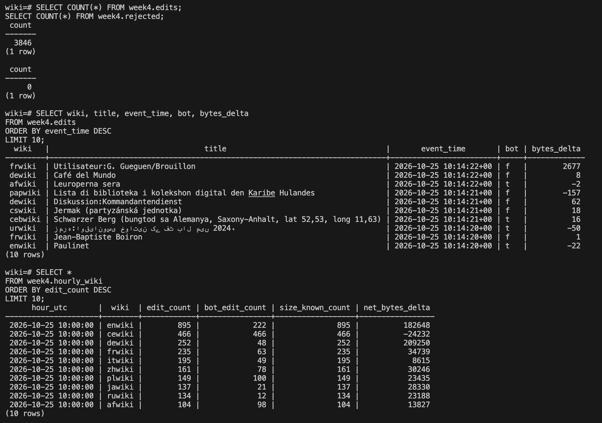

# 4회차 제출 — Wikipedia 편집 데이터 전처리와 저장

데이터 출처는 [Wikimedia EventStreams](https://stream.wikimedia.org/v2/stream/recentchange)다. 2026-10-25 한국시간 19:04:23~19:14:23에 받은 전체 변경 기록은 **25,860건·36.80MB**, 그중 Wikipedia 편집은 **3,846건**이다. 이전 CI에서는 실제 편집 20건 샘플을, 이번 로컬 Spark 실행에서는 **3,846건 전체**를 처리했다.

**로컬 검증 완료:** 원본 편집 3,846건 → DB 3,846행 → Parquet 3,846행, 오류 0건. 같은 입력을 다시 보내도 모든 DB 열과 행 수가 유지됐다. [전체 결과·CSV·동일 이벤트 입출력 예시](../../evidence/week4/full_run_20261028T221020Z/README.md). 기존 Linux CI의 합성 오류·장애 복구 결과는 별도 근거로 보존한다.

## 1. 처리 흐름

```text
수집 JSONL의 Wikipedia 편집 3,846건 → Producer → Kafka
→ Spark: JSON 해석·시각 변환·필수 필드 검사
→ 정상 기록은 PostgreSQL edits / 오류는 rejected
→ 시간·위키별 집계 → Parquet 파일 저장
```

처리 코드: [src/process_edits.py](../../src/process_edits.py)

1. **입력 읽기:** Kafka의 `wikipedia-edits` 토픽에서 key와 JSON 메시지를 읽는다. 첫 실행은 가장 이른 보관 위치부터, 재실행은 checkpoint에 기록한 처리 위치부터 읽는다.
2. **전처리:** 정해 둔 JSON 스키마로 자료형을 읽고, 시각을 UTC로 변환한다. ID·문서명·위키·봇 여부와 메시지 버전을 검사한다. 잘못된 JSON, 시각, 필수 필드 등은 원문과 이유를 오류 테이블에 남긴다.
3. **변환:** 중첩된 `payload`를 열로 꺼내고 `new_length - old_length`로 편집 크기 변화량을 만든다. 길이가 없으면 null을 유지하며, 길이 자체가 음수이면 오류로 분리한다. 삭제 편집에 따른 음수 변화량은 정상이다.
4. **중복·저장:** event_id를 기본 키로 저장하고 같은 ID가 다시 오면 기존 값을 유지한다. 정상 데이터에서 UTC 시간·위키별 편집 수와 봇 편집 수 등을 집계한다.
5. **파일 출력:** 기본 실행은 현재 처리할 Kafka 데이터를 읽고 종료하는 `availableNow` 방식이다. 처리 후 DB 내용을 Parquet snapshot으로 저장한다.

`wiki:문서명`은 Kafka key이고, `event_id`는 개별 편집 식별자다. 같은 문서의 서로 다른 편집을 하나로 합치지 않는다.

## 2. 입력·출력 예시

아래는 이번 로컬 실행에서 동일한 이벤트의 원본과 DB 저장 결과를 발췌한 것이다. 원본에 공통 필드를 붙인 Kafka 메시지가 Spark의 입력이다.

처리 전:

```json
{
  "wiki": "enwiki",
  "title": "1991–92 Aston Villa F.C. season",
  "timestamp": 1792922664,
  "bot": false,
  "length": {
    "old": 24636,
    "new": 27290
  }
}
```

처리 후:

```json
{
  "event_id": "0a3b0c9a-b4a9-4706-86a6-a074d4d35ee6",
  "event_time": "2026-10-25T10:04:24+00:00",
  "wiki": "enwiki",
  "title": "1991–92 Aston Villa F.C. season",
  "bot": false,
  "old_length": 24636,
  "new_length": 27290,
  "bytes_delta": 2654
}
```

- **자료형:** JSON의 숫자·boolean을 스키마로 읽고, 손상된 데이터나 타입 불일치를 오류로 분리한다.
- **시각:** 원래 편집 시각(event_time), Producer 전송 시각(ingest_time), DB 저장 시각(processed_at)을 구분한다. 입력 시각에는 시간대가 명시돼 있어야 한다.
- **결측:** 필수 필드가 빠지면 오류로 보관한다. 길이 정보는 없어도 허용하며, 알 수 없는 값을 0으로 채우지 않는다.
- **중복:** 정상 기록은 event_id가 같으면 처음 저장된 값을 유지한다. 제목이 같다는 이유로 중복 처리하지 않는다.

## 3. 최종 스키마

정의 파일: [sql/week4.sql](../../sql/week4.sql). 정상 편집 한 건을 한 행으로 저장한다.

| 정상 테이블 `week4.edits` 필드 | PostgreSQL 자료형 | 의미 |
|---|---|---|
| event_id | TEXT, 기본 키 | 이벤트 식별자·중복 판단 기준 |
| event_type | TEXT | wikipedia.edit |
| schema_version | INTEGER | 허용 버전 1 |
| event_time | TIMESTAMPTZ | 실제 편집 발생 시각 |
| ingest_time | TIMESTAMPTZ | Producer 전송 직전 시각 |
| source | TEXT | 데이터 출처 |
| wiki / title | TEXT | 위키 이름 / 문서명 |
| bot | BOOLEAN | 봇 편집 여부 |
| old_length / new_length | BIGINT, null 허용 | 편집 전후 문서 크기 |
| bytes_delta | BIGINT, null 허용 | 편집 후 크기 − 편집 전 크기 |
| source_topic | TEXT | 최초 저장 메시지의 Kafka 토픽 |
| source_partition / source_offset | INTEGER / BIGINT | 최초 저장 메시지의 파티션 / 위치 |
| processed_at | TIMESTAMPTZ | 최초 DB 저장 시각 |

길이와 변화량 외의 정상 테이블 필드는 null을 허용하지 않는다. Parquet에는 이 필드들과 UTC 날짜를 나타내는 `event_date`가 추가된다.

오류 테이블 **`week4.rejected`**는 `source_id`(TEXT 기본 키), `source_topic`(TEXT), `source_partition`(INTEGER), `source_offset`(BIGINT), `raw_value`(TEXT), `error_reason`(TEXT), `rejected_at`(TIMESTAMPTZ)를 저장한다. source_id는 `[토픽, 파티션, offset]` 조합이다.

집계 뷰 **`week4.hourly_wiki`**는 `hour_utc`(TIMESTAMP, UTC 의미)와 `wiki`(TEXT)를 기준으로 `edit_count`, `bot_edit_count`, `size_known_count`(각 BIGINT), `net_bytes_delta`(NUMERIC)를 제공한다. 마지막 값은 Parquet에서는 Spark long 합계인 BIGINT로 저장된다. 변화량이 모두 null인 그룹의 합계도 null이다.

## 4. 저장 포맷과 선택 이유

| 저장소 | 역할 | 선택 이유 |
|---|---|---|
| PostgreSQL | 정상·오류 기록 저장, 시간·위키별 SQL 조회 | 기본 키로 중복을 막고 transaction으로 한 묶음의 저장을 관리할 수 있다. |
| Parquet | 날짜별 정상 편집 이력과 시간·위키별 집계 | 필요한 열을 읽는 분석과 Spark 재처리에 사용하기 좋다. |

**실제 로컬 저장 결과:** DB 정상 3,846행, Parquet 3,846행, 오류 0건이다. 시간·위키별 집계는 82행이며 편집 수 합계는 3,846건이다. 원본·DB·Parquet 대조 및 재전송 결과는 [검증 폴더](../../evidence/week4/full_run_20261028T221020Z/README.md)에 저장했다. CSV와 JSONL 전체 출력도 함께 보관했다.

### 실제 DB 조회 화면

아래는 PostgreSQL에 접속해 직접 조회한 화면이다. `week4.edits`는 **3,846행**, `week4.rejected`는 **0행**이며, 정상 편집의 최근 10건과 시간·위키별 편집 수 상위 10개가 표시되어 있다. 봇 여부는 `t`/`f`로 표시되며, 음수 `bytes_delta`는 문서 크기가 줄어든 정상 편집이다.



[이미지 원본 보기](../images/week4-db-query.png)

조회에 사용한 SQL:

```sql
SELECT COUNT(*) FROM week4.edits;
SELECT COUNT(*) FROM week4.rejected;

SELECT wiki, title, event_time, bot, bytes_delta
FROM week4.edits
ORDER BY event_time DESC
LIMIT 10;

SELECT *
FROM week4.hourly_wiki
ORDER BY edit_count DESC
LIMIT 10;
```

이 사진은 DB의 저장·조회 결과를 보여준다. 원본 전체 대조, DB·Parquet 일치, 재전송 전후 동일성은 [별도 검증 파일](../../evidence/week4/full_run_20261028T221020Z/README.md)에 기록했다.

DB를 기준 데이터로 삼고 Parquet은 다시 만들 수 있는 snapshot으로 관리한다. 새 파일을 모두 쓴 뒤 `CURRENT.json`을 교체한다. 조회할 때는 **CURRENT.json이 가리키는 snapshot 하나만** 읽는다. 과거 snapshot을 전부 읽으면 같은 데이터가 중복될 수 있다.

재실행 시 같은 event_id는 DB에 다시 추가되지 않는다. 별도 합성 테스트에서도 DB 저장 직후 실패·checkpoint 재시작·입력 재전송 후 정상 3행이 유지됐다. 오류 원문을 새 Kafka offset으로 다시 보내면 새로운 오류 수신 기록이므로 오류 행은 3행에서 6행으로 늘었다.

## 5. 실행 방법·입출력 위치·운영 범위

프로젝트 최상위 폴더에서 실행한다. Docker Desktop과 Compose, Python 3.9 이상이 필요하다. Spark·Java·Python 패키지는 컨테이너에서 준비한다.

```bash
cd wikipedia-streaming-analytics

# 이미지 빌드 → 샘플 20건 전송 → Spark 처리 → DB·Parquet 검증
python3 scripts/week4.py demo

# 별도 테스트 DB·토픽에서 오류 처리, 장애 복구, 재실행 검증
python3 scripts/week4.py verify

# 실행 상태 확인
python3 scripts/week4.py status
```

| 입력·출력 | 위치 |
|---|---|
| 재현용 입력 파일 | `samples/wikipedia_edits.jsonl` |
| Spark 입력 | Kafka `wikipedia-edits` |
| 정상 / 오류 / 집계 | PostgreSQL `week4.edits` / `week4.rejected` / `week4.hourly_wiki` |
| 처리 진행 위치 | `artifacts/week4/checkpoints/main/` |
| 최신 파일 경로 안내 | `artifacts/week4/parquet/CURRENT.json` |
| 실제 Parquet 파일 | `artifacts/week4/parquet/snapshots/<실행ID>/edits/`, `hourly_wiki/` |
| 로컬 demo 성공 시 생성되는 검증 보고서 | `evidence/week4/demo_verification.json` |
| 복구 테스트 성공 시 생성되는 보고서 | `evidence/week4/recovery_verification.json` |

DB 저장 후 Parquet 출력만 실패했다면 `python3 scripts/week4.py run --export-only`로 다시 내보낼 수 있다. 같은 입력을 두 번 보내고 처리해도 정상 행 수와 집계는 유지돼야 한다.

**범위와 한계:** 이번 Mac의 Docker 환경에서 전체 3,846건의 전처리·저장·재전송을 검증했다. 여러 동시 writer와 대규모 성능 테스트는 포함하지 않았다. 같은 ID의 수정본은 갱신하지 않고 최초 저장 값을 유지하며, DB와 Parquet은 하나의 transaction으로 동시에 갱신되지 않는다.

이전 로컬 Kafka 검증에서는 여러 Airflow 서비스와 함께 실행할 때 메모리 부족 종료가 발생했다. Spark를 실행하기 전 자원 여유를 확인해야 한다. 관련 없는 컨테이너는 임의로 중지하지 않는다.

상세 실행 방법은 [파이프라인 안내](../guides/week4_pipeline.md)에 정리했다.
