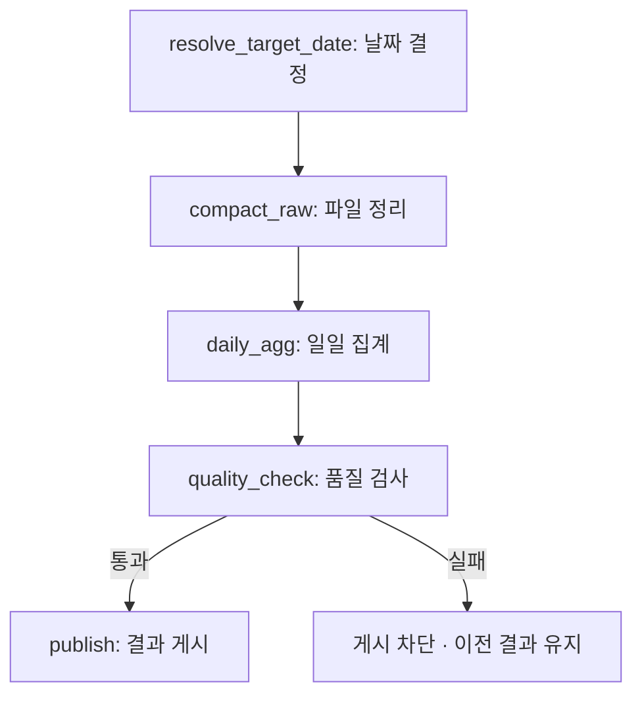
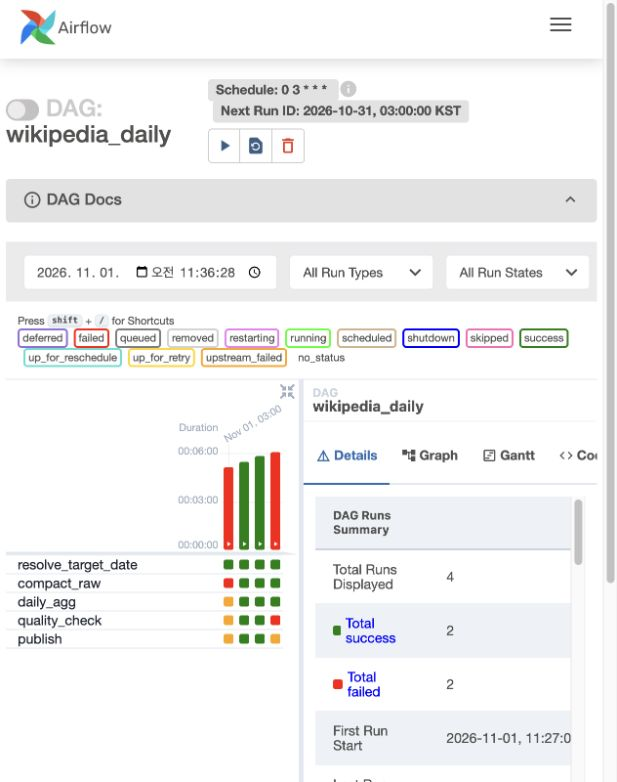

# Wikipedia 일일 데이터 처리 — Airflow

Wikimedia 실시간 편집 API에서 **10분 동안 25,860건·36.80MB**를 수집했다. 이 중 전처리를 거친 Wikipedia 편집 **3,846건**을 이번 작업의 입력으로 사용했다.

**처리 결과: 2026-10-25 편집 3,846건 → 위키별 일일 집계 82개**

> 해당 날짜에 수집한 10분 분량을 날짜 기준으로 집계한 결과다. 하루 전체 편집량을 의미하지 않는다.

## 1. DAG 구조

Airflow는 작업의 순서와 실행 상태를 관리하고, 실제 데이터 처리는 Spark가 수행한다.



| Task | 하는 일 | 결과 |
|---|---|---|
| `resolve_target_date` | 처리할 한국 날짜를 정한다. | `target_date` |
| `compact_raw` | 정상 데이터의 Parquet snapshot을 갱신하고 해당 날짜 파일을 모은다. | 날짜별 처리용 Parquet |
| `daily_agg` | 위키별 편집 수·봇 편집 수·크기 정보 건수·변화량 합계를 계산한다. | 위키별 일일 집계 |
| `quality_check` | 빈 결과·필수값 누락·중복·원본 및 집계 불일치를 검사한다. | 검사 결과 |
| `publish` | 통과한 집계와 게시 정보를 PostgreSQL에 함께 반영한다. | `week5.daily_wiki`, `week5.publications` |

### 품질 검사 후 게시

처리 중인 파일은 실행별 경로에 저장하고, **품질 검사에 통과한 결과만 게시**한다. 집계와 게시 정보는 하나의 DB 트랜잭션으로 반영한다. 비교 기준은 원본 25,860건이 아니라 전처리된 정상 편집 데이터다.



| 화면의 열 — 왼쪽부터 | 실행 결과 |
|---|---|
| 첫 번째 | 초기 Spark 환경 설정 오류. Ivy 경로 수정 완료 |
| 두 번째·세 번째 | 같은 날짜를 두 번 실행하여 모든 Task 성공 |
| 네 번째 | 집계 날짜를 일부러 변경 → 품질 검사 실패 → publish 차단 |

마지막 실행의 `publish`는 `upstream_failed` 상태이며, 이전 정상 게시 결과는 유지됐다. 화면의 Duration은 테스트용 실행 날짜의 영향을 받으므로 성능 측정값으로 사용하지 않는다.

## 2. retry·backoff와 실패 알림

**일시적인 연결 오류는 기다렸다가 다시 시도하고, 입력이나 설정을 고쳐야 하는 오류는 즉시 실패시킨다.**

| 대상 | 대응 | 이유 |
|---|---|---|
| 파일 정리·집계·게시의 일시적인 DB·Docker 연결 오류 | 최대 3회 재시도 | 잠시 기다리면 복구될 수 있음 |
| 위 작업에서 잘못된 데이터·설정 등으로 분류한 오류 | 재시도 없이 실패 | 같은 조건으로 반복해도 해결되지 않음 |
| 날짜 결정 `resolve_target_date` | 재시도 없음 | 날짜 입력을 확인해야 함 |
| 품질 검사 `quality_check` | 재시도 없음 | 원인을 확인하고 결과를 수정해야 함 |

| 설정 | 값 |
|---|---|
| 재시도 횟수 | 최초 실행 이후 최대 3회 |
| 기본 대기 | 1분 |
| 대기 방식 | 지수 백오프: 반복 실패할수록 대기 시간을 늘림 |
| 최대 대기 | 10분 |

실제 대기 시간은 Airflow가 계산한다. 현재 품질 검사 Task는 일시 연결 오류가 발생해도 자동 재시도하지 않는다.

### 실패를 확인하는 방법

```text
최종 실패 → Airflow 실패 상태 + 작업 로그 + alerts.jsonl 기록
```

- 담당자가 Airflow 화면과 `artifacts/week5/alerts.jsonl`을 확인한다.
- 기록 내용: DAG·Task·실행 ID·시도 번호·발생 시각.

**재시도 검증:** 일시 오류 예외를 한 번 주입한 뒤 다음 시도에서 성공했다. 테스트에서만 대기를 1초로 줄였으며, 실제 DB 서버를 중단한 실험은 아니다.

## 3. 스케줄·처리 날짜·의존성

### 실행 날짜와 데이터 날짜

**매일 한국시간 03:00에 전날 00:00~24:00 데이터를 처리한다.**

| 구분 | 예시 |
|---|---|
| 실행 시각 | 2026-11-02 03:00 KST |
| 처리할 날짜 | 2026-11-01 |
| 데이터 범위 | 11월 1일 00:00 이상 ~ 11월 2일 00:00 미만, 한국시간 |
| 과거 날짜 재처리 | `target_date=2026-10-25` 지정 |

날짜는 현재 시각이 아니라 **`data_interval_end`를 한국시간으로 바꾼 날짜의 전날**로 정한다. 실행이 늦어져도 처리 날짜가 바뀌지 않는다. `target_date`를 지정하면 그 날짜를 우선한다.

| 실행 설정 | 목적 |
|---|---|
| `schedule='0 3 * * *'`, `Asia/Seoul` | 매일 한국시간 03시 실행 |
| `catchup=False` | 누락된 과거 구간 전체가 한꺼번에 자동 실행되지 않도록 설정 |
| `max_active_runs=1` | DAG 실행이 겹치지 않도록 제한 |

### 이 순서로 실행하는 이유

**날짜 확정 → 같은 날짜의 파일 준비 → 집계 → 결과 검사 → 게시**

앞 단계가 성공해야 다음 단계가 실행된다. 특히 검사 전에 게시하지 않도록 `quality_check → publish` 의존성을 설정했다.

### 같은 날짜를 두 번 실행해도 안전한가?

- **같은 입력 버전:** 다시 게시하지 않아 기존 결과를 유지한다.
- **입력이 변경된 경우:** 해당 날짜의 집계를 갱신한다.
- **검사 실패:** 새 결과를 게시하지 않고 이전 결과를 유지한다.

| 검증 항목 | 확인 결과 |
|---|---|
| 동일 날짜 두 번 실행 | 집계 값·갱신 시각·게시 정보 모두 동일 |
| 품질 오류 주입 | quality_check 실패, publish 차단 |
| 실패 전후 비교 | 이전 게시 결과 유지 |
| 실패 기록 | 로컬 알림 파일에 기록됨 |

실행마다 중간 파일 경로는 새로 생성된다. 동일하게 유지되는 대상은 **게시된 결과**다.

> 검증은 Airflow `dag.test()`에서 실제 Spark 컨테이너와 DB 작업을 실행한 결과다. 정시 자동 실행과 외부 웹훅 알림은 아직 검증하지 않았다. 검증 종료 시 DAG는 일시 정지 상태로 두었다.

[검증 결과 JSON](../../evidence/week5/verification.json) · [DAG 코드](../../dags/wikipedia_daily.py) · [실제 처리 코드](../../src/daily_jobs.py) · [날짜·알림·실행 연결 코드](../../src/airflow_support.py)

---

## 참고: 실행과 결과 확인

프로젝트 폴더에서 Docker Desktop을 실행한 뒤:

```bash
python3 scripts/week5.py setup
python3 scripts/week5.py verify
```

검증은 기존 2026-10-25 정상 편집 3,846건이 저장된 환경을 기준으로 한다. 새 환경에서는 먼저 기존 수집 데이터의 Kafka→Spark→DB 처리가 필요하다. 샘플 20건만으로는 이 전체 데이터 검증을 통과하지 않는다.

화면: http://localhost:18080 · 로컬 실습 계정: `airflow` / `airflow`

스케줄러를 통한 수동 실행:

```bash
python3 scripts/week5.py trigger --date 2026-10-25
python3 scripts/week5.py status
```

`trigger`는 DAG의 일시 정지도 해제한다. 이후 매일 정기 실행되므로 실습 종료 후 화면에서 DAG를 다시 정지하거나 아래 명령을 사용한다. 데이터가 없는 날짜는 품질 검사에서 실패하는 것이 정상이다.

```bash
python3 scripts/week5.py stop
```

결과 위치:

- `artifacts/week5/runs/<실행 ID 해시>/2026-10-25/`: 단계별 JSON·Parquet·로그
- `evidence/week5/verification.json`: 성공·재실행·실패 차단 검증 기록
- `week5.daily_wiki`: 날짜·위키별 집계. `(target_date, wiki)`가 기본키다.
- `week5.publications`: 품질 검사를 통과한 게시 버전과 파일 위치

DB에서 `SELECT * FROM week5.daily_wiki ORDER BY target_date, edit_count DESC;`로 확인할 수 있다.

같은 입력 버전은 다시 게시하지 않고, 바뀐 데이터는 해당 날짜만 upsert한다. 이번 규모에서는 compaction을 파일 하나로 모았다. 대규모 환경에서는 파일 크기에 따라 분할 수를 조정해야 한다. 6회차 부하 테스트는 이번 과제 범위에 포함하지 않았다.

