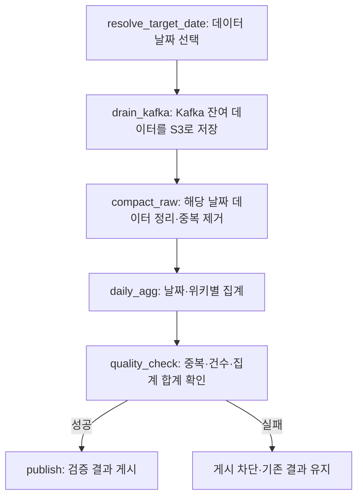
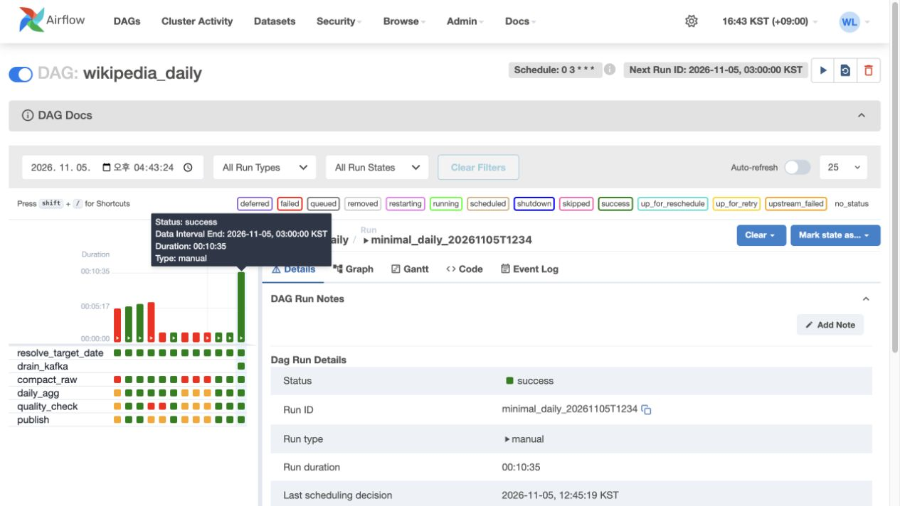

# 5주차 제출 — Airflow 작업 흐름과 안정적인 재실행

Wikimedia 실시간 변경 API에서 처음 **10분간 25,860건·36.80MB**를 수집했고, 그중 Wikipedia 편집은 **3,846건**이었다. 현재 S3 방식은 별도의 **2026-11-02 편집 12,947건 → 날짜·위키별 집계 121개**로 검증했다. 두 입력은 서로 다르며 날짜별 집계가 하루 전체 수집을 뜻하지는 않는다.

## 1. DAG 구조 — 각 Task가 하는 일

Airflow가 순서와 실패를 관리하고, 실제 처리는 Spark가 한다. 결과는 S3에 저장한다. 집계 전에 `drain_kafka`로 Kafka 잔여 데이터를 저장하고, 총 6개 Task를 순서대로 실행한다.



| Task | 하는 일 | 출력 |
|---|---|---|
| `resolve_target_date` | 처리할 한국 날짜 결정 | `target_date` |
| `drain_kafka` | 체크포인트에서 Kafka를 읽어 Spark로 검증·저장 | S3 Parquet·완료 commit·체크포인트 |
| `compact_raw` | 대상 날짜 파티션을 읽고 정상 행의 `event_id` 중복 제거 | 실행별 정상 데이터 Parquet |
| `daily_agg` | 위키별 편집 수·봇 편집 수·크기 정보 건수·변화량 합계 계산 | 집계 Parquet |
| `quality_check` | 저장 건수·고유 ID 수·집계 합계 대조 | 검사 통과 기록 |
| `publish` | 검사한 경로가 변경되지 않았는지 확인 후 게시 | 날짜별 `current.json` |

### 결과를 내보내기 전에 검사

중간 결과는 실행별 경로에 쓴다. **품질 검사를 통과한 결과만 `current.json`으로 공개**한다. 실패한 Parquet 경로는 완료 commit에 포함되지 않는다. 기존 결과를 먼저 삭제하지 않으므로 중간 실패로 이전 게시물이 사라지지 않는다.

빈 날짜는 `compact_raw`에서 실패한다. 필수값·형식 검사는 앞단 Spark 변환에서 수행하고 오류 행은 정상 집계에서 제외한다. 현재 품질 Task에는 **필수값 null 비율이나 전일 대비 급감 비율을 별도 계산하는 검사는 없다.**

### Airflow Grid 화면



2026-11-05 캡처. 맨 오른쪽 열은 `minimal_daily_20261105T1234`이며 6개 Task가 모두 초록색이다. 오른쪽 상세 상태도 `success`다. 왼쪽의 과거 실패 이력은 삭제하지 않았다. 화면의 10분 35초에는 작업 대기가 포함되며, 이벤트 지연 p95가 아니다.

[해당 실행의 Task 상태](../../evidence/spark_s3/minimal_runtime.json) · [현재 DAG 코드](../../dags/wikipedia_daily.py)

## 2. retry·backoff와 실패 알림

**일시 통신 오류는 재시도하고, 같은 입력으로 반복해도 해결되지 않는 오류는 바로 실패시킨다.**

| Task·실패 종류 | 현재 대응 |
|---|---|
| `drain_kafka`, `compact_raw`, `daily_agg`, `publish`의 알려진 일시 S3·Docker 오류 | 최대 3회 추가 재시도 |
| 위 작업의 권한·설정·데이터 오류 등 영구 오류 | `AirflowFailException`으로 즉시 실패 |
| `resolve_target_date`의 잘못된 날짜 | `retries=0`, 즉시 실패 |
| `quality_check` | `retries=0`, 불일치 시 실패하고 게시 차단 |

기본 대기는 1분, 지수 백오프를 사용하며 최대 10분으로 제한한다. 약 1→2→4분처럼 늘어나는 방식이지만 실제 대기는 Airflow가 계산한다. **품질 Task는 일시 통신 오류가 나도 현재 자동 재시도하지 않는다.**

### 누가, 어떻게 실패를 아는가?

현재 담당자는 프로젝트 운영자이며, Airflow 화면과 `artifacts/airflow/alerts.jsonl`을 직접 확인한다. 최종 실패 callback은 DAG·Task·실행 ID·시도 번호·발생 시각을 기록한다.

Discord 등 외부 메시지 발송은 연결하지 않았다. 현재 실패 여부는 운영자가 화면과 로그에서 직접 확인한다.

## 3. 스케줄·처리 날짜·의존성

| 항목 | 설정·의미 |
|---|---|
| 일일 집계 | `0 3 * * *`, 한국시간 매일 03시 |
| 데이터 날짜 | `data_interval_end`를 한국시간으로 바꾼 날짜의 전날 |
| 수동 재처리 | `target_date`를 지정하면 해당 날짜 우선 |
| 과거 구간 | `catchup=False`; 생성되지 않은 과거 구간은 수동 지정 |
| 동시 실행 | DAG별 실행 1개, 모든 Spark Task가 `spark_jobs` 1개 슬롯 공유 |
| 별도 수집 DAG | `wikipedia_ingest`가 10분마다 Kafka→Spark→S3 처리 |

예를 들어 **11월 5일 03시를 기준으로 만들어진 실행은 11월 4일 데이터**를 처리한다. 실제 실행이 늦어져도 이 기준은 바뀌지 않는다. 과거 데이터는 실행 날짜를 과거로 바꾸지 않고 `target_date`로 지정한다.

이 순서는 **날짜를 정하고 → 잔여 입력을 저장하고 → 같은 날짜를 정리·집계하고 → 검사한 다음 게시**하기 위한 것이다.

### 같은 날짜를 두 번 실행한 결과

같은 입력으로 재실행한 정상 데이터 12,947행과 집계 121행을 Spark `exceptAll`로 양방향 비교했고, 전체 값이 같았다. 다만 실행별 파일 경로와 `current.json`이 가리키는 경로는 달라질 수 있다. **보장하는 것은 데이터 내용의 동일성이며, 파일 경로나 갱신 시각의 동일성이 아니다.**

[재실행 대조 기록](../../evidence/spark_s3/verification.json)

## 실행

```bash
export WIKI_AWS_HOST="$HOME/.aws"
export WIKI_DOCKER_SOCKET=/var/run/docker.sock
python3 scripts/operations.py trigger --date 2026-11-02
python3 scripts/operations.py ui
python3 scripts/operations.py ui-stop
```

현재 기본 서비스가 실행 중인 환경에서 사용하는 명령이다. 웹 화면은 확인할 때만 켠다.

[날짜·재시도 연결 코드](../../src/airflow_support.py) · [실제 처리 코드](../../src/spark_s3.py) · [6주차 동작·검증 결과](week6.md)
