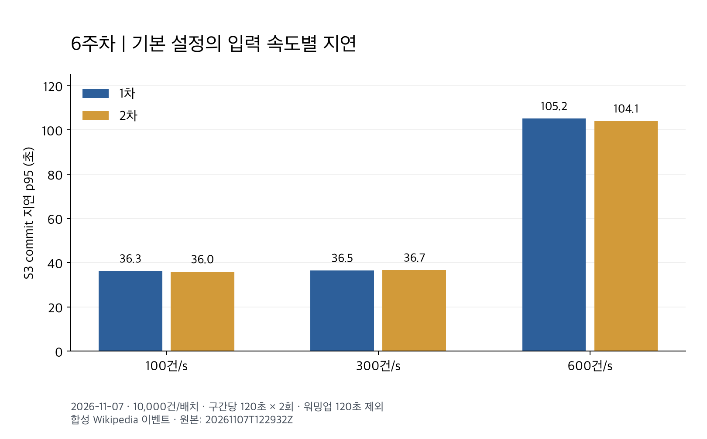
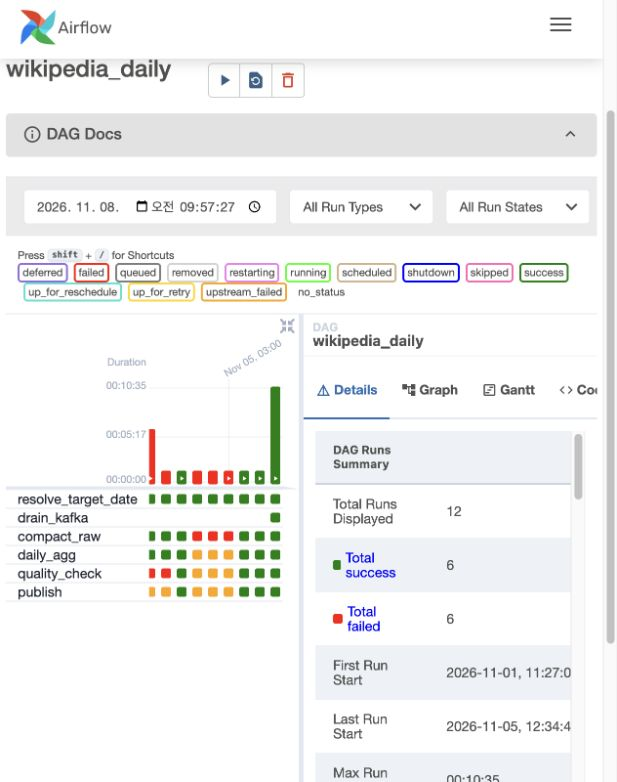
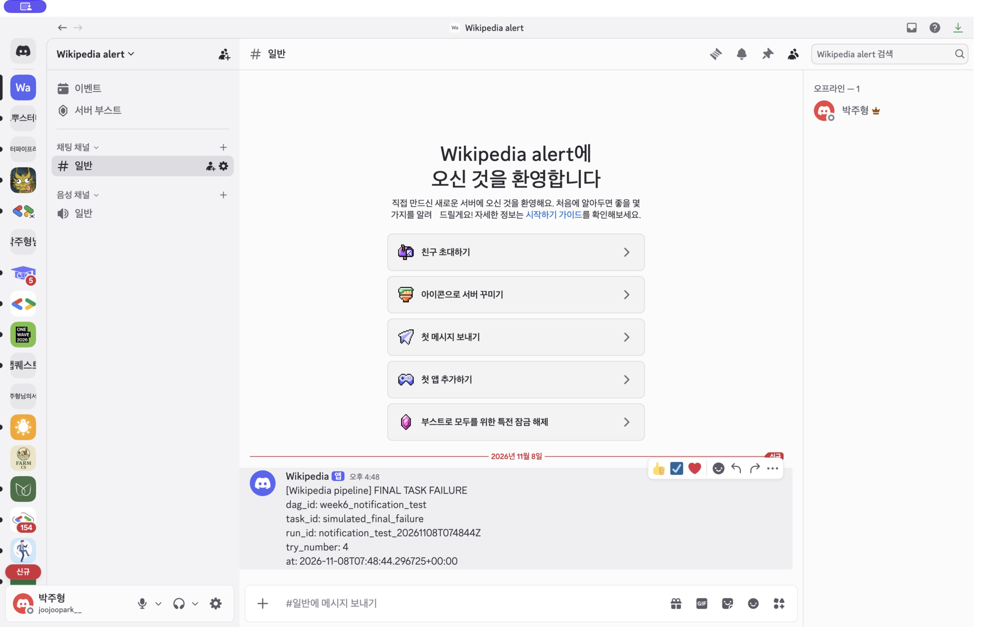
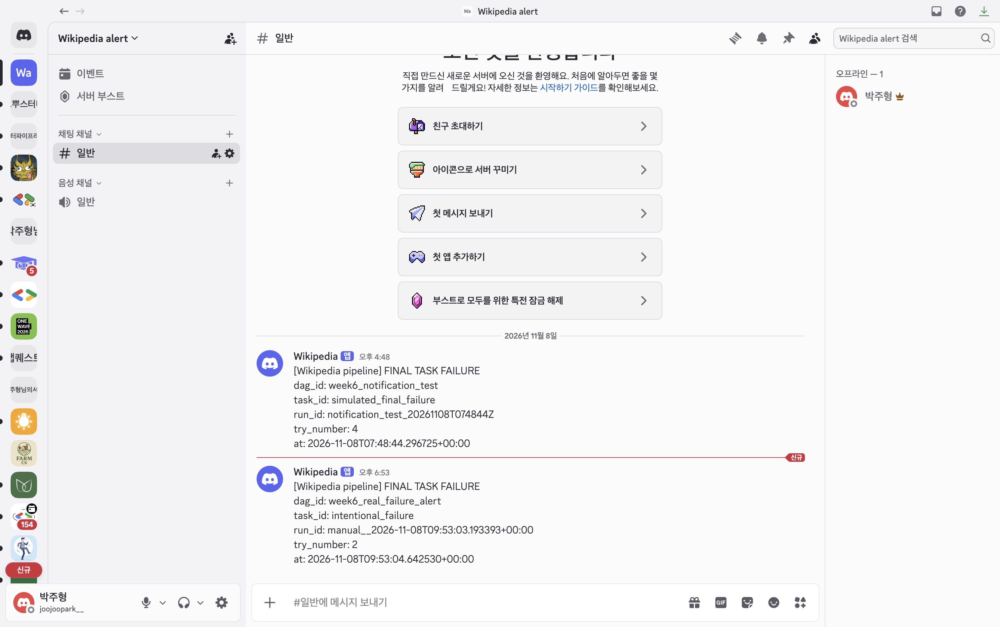

# 6주차 — 부하 테스트와 장애 복구

작성일: **2026-11-08**

부하·Spark 강제 종료 테스트: 2026-11-07 / Kafka·저장 오류·작업 재시도 테스트: 2026-11-08

이 프로젝트는 Wikipedia 편집 이벤트를 **Producer → Kafka → Spark → S3** 순서로 처리합니다. 이번 실습에서는 입력이 많아질 때 어디에서 지연되는지, 처리 도중 문제가 생겨도 데이터가 빠지거나 중복되지 않는지 확인했습니다.

**기본 설정에서는 600건/초 입력을 따라가지 못해 지연이 증가했습니다. 부하 테스트의 252,000건은 누락 없이 저장됐으며, Spark 강제 종료와 오늘 수행한 장애 테스트에서도 확인한 데이터의 누락·offset 중복은 0건이었습니다.** 최종 실패 알림의 Discord 실제 수신도 확인했습니다. 정확한 Kafka 복구 시간은 아직 확인하지 못했습니다.

## 1. 테스트 환경과 확인 기준

실제 Kafka·Spark·AWS S3를 사용하되, 입력은 Wikipedia 이벤트 형식에 맞춘 평균 약 400바이트의 합성 데이터로 만들었습니다. 운영 데이터와 섞이지 않도록 테스트용 Kafka와 S3 경로를 분리했습니다.

| 항목 | 설정 |
|---|---|
| Docker | 29.2.0, CPU 10개·메모리 약 7.65GiB 할당 |
| Kafka | 3.8.0, 단일 브로커, 파티션 3개, 메모리 상한 1GiB |
| Spark | 3.5.8, local[2], driver 1GiB, 컨테이너 상한 2GiB |
| 처리 설정 | shuffle partitions 2, 30초 간격, 배치당 최대 10,000건 |
| 저장 | S3 Parquet 파일, 처리 완료 기록(commit), 재시작 위치(checkpoint) |

문서에서 사용하는 지표는 다음과 같습니다.

- **실제 입력률**: Producer가 보낸 메시지 중 Kafka가 받았다고 확인한 건수를 초당으로 계산한 값입니다.
- **지연 p95**: 이벤트를 만든 뒤 S3에 저장 완료되기까지 걸린 시간 중 95%가 이 값 이내라는 뜻입니다.
- **lag**: Kafka에는 들어왔지만 S3 저장 완료가 확인되지 않은 건수입니다. 5초마다 기록했습니다.
- **중복 확인**: 원시 저장은 Kafka의 메시지 위치인 offset으로, 최종 정상 결과는 이벤트의 event_id로 확인했습니다. 의도적으로 중복 전송한 입력과 처리 오류로 생긴 중복을 구분합니다.

운영 환경은 Airflow가 10분마다 Spark를 실행하지만, 부하 테스트는 30초 간격의 연속 스트리밍으로 진행했습니다. 따라서 아래 지연에는 운영의 예약 대기 시간이 포함되지 않습니다. 다른 Kubernetes 작업도 실행 중이어서 완전히 통제된 성능 측정은 아닙니다.

## 2. 입력을 늘렸을 때의 결과

처음 120초는 준비 구간으로 제외하고, 100→300→600건/초를 각 120초씩 두 번 측정했습니다. 각 단계의 남은 데이터를 모두 처리한 뒤 다음 단계로 넘어갔습니다.



| 입력 조건 | 반복 | 실제 입력 건/초 | 측정 구간 내 저장 완료 건/초 | 지연 p95 초 | 최대 lag 건 |
|---|---|---:|---:|---:|---:|
| 100건/초 | 1차 | 100.01 | 91.85 | 36.28 | 3,500 |
| 300건/초 | 1차 | 300.00 | 275.32 | 36.54 | 10,570 |
| 600건/초 | 1차 | 600.01 | 333.28 | 105.17 | 39,311 |
| 100건/초 | 2차 | 100.01 | 91.42 | 35.98 | 3,596 |
| 300건/초 | 2차 | 300.01 | 274.02 | 36.70 | 10,893 |
| 600건/초 | 2차 | 600.00 | 333.29 | 104.07 | 39,646 |
| 7주차 동일 조건 재측정: 개선 전 10,000, 600건/초 | 1회 | 600.00 | 333.27 | 105.79 | 39,105 |
| 7주차 동일 조건 재측정: 개선 후 50,000, 600건/초 | 1회 | 600.01 | 530.69 | 36.65 | 20,364 |

마지막 두 행은 2026-11-08의 [7주차 B안 동일 조건 비교](week7.md)입니다. 두 실행 모두 준비 60초·측정 120초·1회이며 읽기 상한만 바꿨습니다. 위의 6주차 원래 실험(준비 120초·2회)과는 구분하며, 개선율은 마지막 두 행끼리만 비교합니다. 이전 60초 간이 결과는 이번 비교에서 제외하고 원본 증빙만 보존했습니다.

저장 완료 처리률은 각 측정 구간 안에 완료된 건수만 계산합니다. 마지막 배치가 측정 구간 뒤에 끝나면 입력률보다 낮게 보일 수 있으므로, 이 값만으로 최대 처리량을 판단하지 않았습니다. lag도 30초마다 내려가는 형태여서 순간적인 크기보다 시간에 따라 계속 쌓이는지를 봤습니다.

100·300건/초에서는 p95가 약 36초로 비슷했지만, 600건/초에서는 두 번 모두 약 104~105초로 늘고 lag도 증가했습니다. 준비 구간을 포함한 **252,000건 모두 저장됐고, 정상 ID 누락·예상 밖 ID·Kafka offset 중복은 0건**이었습니다.

## 3. 어디에서 지연됐는가

배치 안에서 시간을 나눠 측정한 결과입니다. 준비 구간은 제외했습니다.

| 배치 내부 작업 | 평균 시간 |
|---|---:|
| 데이터 변환·건수 확인 | 0.336초 |
| S3 Parquet 파일 쓰기 | 6.077초 |
| 날짜·offset 등 부가정보 계산 | 0.098초 |
| 저장 완료 기록 쓰기 | 0.092초 |

Spark가 기록한 전체 배치 실행 시간(`triggerExecution`)은 평균 **8.396초**였습니다. 이 중 실제 처리·저장(`addBatch`)은 6.791초, 체크포인트 관련 기록은 `walCommit` 0.841초·`commitOffsets` 0.723초였습니다. 내부 작업과 Spark 지표는 측정 범위가 겹치므로 서로 더하지 않습니다.

S3 쓰기가 배치 안에서 가장 오래 걸렸지만, 전체 배치는 30초보다 빨리 끝났습니다. 그럼에도 **30초마다 최대 10,000건만 읽는 설정** 때문에 읽을 수 있는 양은 대략 `10,000 ÷ 30 = 333건/초`로 제한됩니다. 600건/초가 들어오면 한 번 처리하고도 데이터가 남아 다음 순서를 기다리게 됩니다.

실제로 배치가 약 10,000건에 머물고 lag가 계속 증가했습니다. 따라서 이번에 확인한 주요 제한은 **처리 간격과 배치당 읽기 상한의 조합**입니다. 정확한 최대 처리량을 찾거나 운영 전체 지연을 측정한 결과는 아닙니다.

## 4. 장애가 발생해도 결과가 유지되는가

장애 테스트에서는 단순히 프로그램이 다시 실행되는 것뿐 아니라, 입력이 빠짐없이 저장되는지와 최종 결과가 중복되지 않는지를 확인했습니다.

### 4-1. Spark를 처리 도중 강제로 종료

2026-11-07에는 **S3에 파일은 썼지만 저장 완료 기록을 남기기 직전**에 Spark를 강제 종료했습니다. 파일만 있고 완료되지 않은 작업을 정상 결과로 읽지 않는지 확인하기 위한 상황입니다.

입력은 정상 고유 이벤트 1,100건, 의도적인 중복 입력 100건, 오류 20건으로 총 1,220건이었습니다. 오류는 JSON 형식이 깨진 메시지 10건과 지원하지 않는 스키마 메시지 10건입니다.

- Spark를 다시 실행한 뒤 스트림 처리가 끝나기까지 **18.03초** 걸렸습니다.
- 원시 저장은 1,220건이며 고유 Kafka offset 수도 1,220개였습니다.
- 정상 게시 결과는 1,100건, 고유 event_id도 1,100개, 집계 합계도 1,100건이었습니다.
- 실패 전에 게시되어 있던 결과는 유지됐습니다.

즉, 중복 입력은 원시 데이터에 남기되 정상 결과에서는 한 번만 집계했고, 미완료 파일 때문에 기존 게시 결과가 바뀌지는 않았습니다.

### 4-2. Kafka를 60초 동안 멈춤

**오늘(2026-11-08)** 테스트용 Kafka를 60초 동안 실제로 일시 정지했습니다. 그동안 Producer가 3,000건을 보내도록 하고 Spark도 실행 상태로 두었습니다. 메시지를 받아 주는 Kafka가 잠시 응답하지 않을 때를 재현한 것입니다.

중단 중에는 연결 타임아웃과 재시도 로그가 발생했습니다. Kafka를 다시 실행하자 **3,000건 모두 수신 확인(ACK)을 받았고, 최종 전송 실패는 0건**이었습니다. 저장 결과에서도 정상 ID 누락과 offset 중복이 없음을 확인했습니다.

다만 Kafka가 복구된 순간부터 lag가 0이 될 때까지의 정확한 시간은 파일로 보존되지 않았습니다. 복구와 정합성은 확인했지만, 복구 시간 수치는 이번 결과에 포함하지 않았습니다.

### 4-3. 입력의 절반을 오류 메시지로 전송

오늘 정상 메시지 1,000건과 오류 메시지 1,000건을 섞어 보냈습니다. 오류 메시지는 **깨진 JSON 500건과 지원하지 않는 스키마 500건**으로 구성했습니다. 입력 형식에 문제가 많이 생겨도 정상 메시지 처리가 함께 멈추지 않는지 확인했습니다.

결과는 **정상 1,000건 + 오류 1,000건 = 입력 2,000건**으로 맞았습니다. 정상 ID 누락은 없었으며, 오류 메시지도 버리지 않고 원문(`raw_value`)과 오류 이유(`error_reason`)를 보관했습니다.

이 프로젝트에서는 별도 Kafka DLQ 토픽 대신, 저장된 오류 행이 나중에 원인을 조사하는 보관함 역할을 합니다. 정상 집계를 만들 때는 이 오류 행을 제외합니다.

### 4-4. S3 파일 저장 뒤 완료 기록에 오류 발생

오늘 S3에 Parquet 파일을 실제로 쓴 뒤, **60초를 기다리고 완료 기록을 쓰는 단계에서 일시 오류(`ServiceUnavailable`)가 발생하도록 설정**했습니다. AWS 서비스 자체를 중단한 것은 아니며, 저장 도중 문제가 생겼을 때의 처리 경로를 확인한 것입니다.

프로그램은 재시도 가능한 오류를 뜻하는 종료 코드 75로 끝났습니다. 다시 실행한 뒤에는 기존 게시 결과를 유지하면서 남은 입력을 저장했습니다. 재실행 컨테이너를 요청한 시점부터 S3 완료 기록까지는 **16.99초**였습니다. 앞의 Spark 강제 종료 복구 시간과는 측정 시작·종료 기준이 다릅니다.

이 시점의 누적 입력과 저장은 모두 **5,600건**, 고유 Kafka offset도 5,600개였습니다. 정상 ID 누락과 예상 밖 ID는 0건이었습니다.

### 4-5. 일일 집계 작업 실패와 Airflow 재시도



위 이미지는 2026-11-08에 `http://localhost:18080`의 실제 Airflow 웹 UI를 캡처한 화면입니다. `wikipedia_daily`의 기존 실행 이력 12회(성공 6회, 실패 6회)와 작업별 상태를 보여줍니다. 화면의 실행 이력은 11월 1~5일 기록이며, 아래 11월 8일 재시도 테스트의 실행 화면은 아닙니다. 해당 테스트의 임시 SQLite DB는 실행 후 정리되어 웹 UI에 남아 있지 않으므로, 재시도 결과는 아래 원본 JSON 기록으로 확인합니다. 캡처를 위해 웹서버와 DB만 실행했으며 스케줄러는 중지된 상태입니다.

오늘 일일 작업에서는 파일을 쓴 뒤, 그 파일의 위치를 기록하는 단계에 일시 오류(`SlowDown`)를 발생시켰습니다. **같은 작업 ID로 다시 실행했을 때 결과가 처음 정상 실행한 것과 같은지** 확인했습니다. 정상 데이터와 집계 내용을 양쪽 방향으로 비교한 결과, 다른 행은 0건이었습니다.

Airflow에서도 격리된 테스트 실행을 통해 실제 TaskInstance의 재시도를 확인했습니다.

| 시도 | 결과 |
|---|---|
| 첫 번째 시도 | 일시 저장 오류로 실패, 종료 코드 75 |
| 두 번째 시도 | 재시도 성공, 종료 코드 0 |
| 최종 DAG 상태 | success |
| 정상 결과 | 4,600건, 비교한 정상 행·집계 결과의 차이 0건 |

Airflow는 별도의 SQLite와 `DAG.test()`를 사용했습니다. **작업의 재시도는 검증했지만 운영 스케줄러 전체를 중단·복구한 실험은 아닙니다.**

오늘 사용한 데이터는 준비용 100건, Kafka 중단 구간 3,000건, 정상·오류 혼합 2,000건, 저장 오류 구간 500건으로 총 5,600건입니다. 이 중 오류 1,000건을 제외한 정상 데이터가 4,600건이므로 최종 건수도 일치합니다.

## 5. 코드 보완과 검증 기록

- Producer의 대기 시간이 음수가 되면 멈출 수 있는 문제를 수정했습니다.
- 이미 계산해 둔 데이터를 이용해 offset 정보를 구하도록 정리했습니다.
- Spark가 저장 오류를 다른 예외로 감싸더라도 원래 원인을 보존해, S3 일시 오류를 재시도 대상으로 판단할 수 있게 했습니다.
- 테스트 결과는 단계마다 저장하도록 바꿔 후속 단계가 실패해도 앞선 결과가 남게 했습니다.
- 단위 테스트는 **20개 통과**했습니다. 이 문서의 실제 부하·장애 검증과 별도로, 기존 Spark 통합 테스트 파일을 모두 다시 실행한 것은 아닙니다.

Airflow 테스트의 첫 실행은 컨테이너 사용자명 설정이 없어 시작 단계에서 실패했습니다. 사용자 환경 설정을 보완하고 Airflow 단계만 다시 실행해 위 결과를 얻었습니다. 처음의 실패 기록과 재실행 성공 기록을 함께 보존했습니다.

### 5-1. 최종 실패 알림 구현 (2026-11-08)

`wikipedia_daily`와 `wikipedia_ingest`의 최종 작업 실패 콜백을 확장했습니다. 일시적인 실패로 재시도하는 동안에는 알리지 않고, 재시도를 모두 사용했거나 즉시 실패로 처리된 작업에 대해 알립니다.

1. DAG·작업·실행 ID, 시도 번호, 발생 시각을 `artifacts/airflow/alerts.jsonl`과 SQLite 보관함에 저장합니다.
2. `DISCORD_WEBHOOK_URL`이 설정되어 있으면 Discord로 전송합니다. 같은 DAG·실행·작업의 전송 완료 기록이 있으면 다시 보내지 않습니다.
3. 웹훅이 없거나 전송에 실패하면 미전송 상태로 보관합니다. 네트워크 요청은 5초 제한을 두고, 알림 실패가 원래 작업의 처리 결과를 덮어쓰지 않게 했습니다. 웹훅 주소나 원본 예외 메시지는 알림에 포함하지 않습니다.
4. 보관된 알림은 아래 명령으로 최대 20건씩 다시 전송할 수 있습니다. 자동 재전송 서비스는 아니므로 연결 복구 후 직접 실행합니다.

```bash
# .env.local에 DISCORD_WEBHOOK_URL을 설정한 뒤 기존 운영 환경에서 적용
# 기존 실행 안내의 WIKI_AWS_HOST·WIKI_DOCKER_SOCKET 환경 설정을 사용합니다.
docker compose --env-file .env.local up -d --no-deps airflow-scheduler

# 미전송 알림 다시 보내기
docker compose --env-file .env.local exec -T airflow-scheduler python -m src.alerts retry-pending
```

웹훅은 Git에서 제외된 `.env.local`에만 설정합니다. 환경 변수 변경은 컨테이너를 다시 생성해야 적용됩니다. 보관함의 `alerts.sqlite3`를 유지해야 재시작 후에도 중복 억제와 재전송이 가능합니다. 수신 직후 프로세스가 종료되어 전송 완료 기록을 남기지 못하면 재전송 시 중복이 생길 수 있으므로, 외부 전송의 정확히 한 번 처리를 보장하지는 않습니다.

**검증:** 웹훅 미설정, 전송 실패 후 재전송, 중복 억제, 다른 실행의 개별 알림, HTTP 요청 형식·시간 제한, 저장 오류 격리를 단위 테스트 5개로 확인했습니다. [테스트 기록](../../evidence/week6/alerts/tests.txt). 단위 테스트의 HTTP 전송은 모의 객체를 사용했습니다. 이어서 아래와 같이 실제 Discord 전송과 수신을 확인했습니다. Airflow 내부 실행과 자동 콜백 검증 결과는 5-3절에 정리했습니다.

### 5-2. 실제 Discord 수신 확인 (2026-11-08)

2026-11-08 16:48 KST에 운영 코드의 `notify_failure`를 테스트용 최종 실패 정보로 직접 호출했습니다. `Wikipedia alert` 서버의 `#일반` 채널에서 `Wikipedia` 웹훅이 보낸 메시지를 실제 Discord 앱으로 확인하고 아래 화면을 캡처했습니다.



- 테스트 실행 ID: `notification_test_20261108T074844Z`
- 전달 내용: DAG `week6_notification_test`, 작업 `simulated_final_failure`, 시도 번호 4와 발생 시각
- 최초 전송은 HTTP 오류로 보관함에 남았습니다. 명시적인 `User-Agent` 헤더를 설정한 뒤 같은 알림을 재전송해 **전송 1건, 미전송 0건**을 확인했습니다.
- 동일 실패 콜백을 다시 호출한 결과는 `duplicate`였으며, 두 번째 메시지 전송을 억제했습니다.

이번 검증은 **실제 HTTP 전송 → Discord 수신 → 화면 확인**을 수행했습니다. 최종 실패 정보와 시도 번호는 테스트 입력이며, Airflow 작업을 실제로 네 번 실행하거나 재시도를 소진시킨 실험은 아닙니다. 앞 절의 실제 Airflow 재시도 검증과 이번 외부 알림 수신 검증은 구분합니다. [전송·중복 억제 기록](../../evidence/week6/alerts/delivery-test.json)

### 5-3. 실제 Airflow 실패부터 자동 알림까지 확인 (2026-11-08)

2026-11-08 18:53 KST에 Airflow 2.10.5 컨테이너에서 테스트 전용 DAG `week6_real_failure_alert`를 실행했습니다. `intentional_failure` 작업은 의도적으로 예외를 발생시키며, 재시도 1회와 대기 1초를 설정했습니다. 운영 데이터나 Spark 작업을 실행하지 않아 짧은 시간에 알림 경로만 확인할 수 있었습니다.

| 단계 | 실제 결과 |
|---|---|
| 1차 작업 실행 | 예외 발생, 재시도 대상으로 전환 |
| 2차 작업 실행 직전 | 알림 보관함 0건: 재시도 중에는 알리지 않음 |
| 2차 작업 실행 | 다시 예외 발생, 재시도 소진으로 최종 실패 |
| 실패 콜백 | Airflow가 운영 코드의 `notify_failure`를 자동 호출 |
| Discord 수신 | `Wikipedia alert` 서버 `#일반`에서 해당 실행의 알림 1건 확인 |



화면 아래 **오후 6:53 메시지**가 이번 실제 작업 실패에 따른 자동 알림입니다. `dag_id: week6_real_failure_alert`, `task_id: intentional_failure`, `try_number: 2`가 실행 기록과 일치합니다. 위의 오후 4:48 메시지는 5-2절의 콜백 직접 호출 테스트입니다.

테스트 DAG의 최종 상태 `failed`는 의도한 결과입니다. 검증 스크립트는 실제 두 차례 실행, 재시도 중 알림 0건, 최종 실패 후 전송 완료 1건을 확인하고 정상 종료했습니다. 알림 콜백을 테스트 코드에서 직접 호출하지 않았습니다.

실행은 **격리된 SQLite와 `DAG.test()`**를 사용했으며 운영 스케줄러가 예약 시각에 작업을 배정하는 경로까지 포함한 검증은 아닙니다. 테스트 컨테이너는 종료 후 정리했고, 실행 DB와 상세 로그는 `artifacts/week6/alert-e2e-20261108T095259Z/`에 남겼습니다.

[자동 알림 검증 결과](../../evidence/week6/alerts/airflow-e2e.json) · [테스트 코드](../../tests/performance/week6_alert_e2e.py)

## 6. 남은 확인 사항

- **지표 기반 자동 감시**: lag 증가·입력 중단·오류율·지연 기준은 운영안이며, 주기적 측정과 알림 연결은 아직 구현하지 않았습니다. 이번에 구현한 범위는 Airflow 작업의 최종 실패 알림입니다.
- **정확한 Kafka 복구 시간**: 복구·저장 정합성은 확인했지만 타이머 결과가 후속 Airflow 초기화 실패 전에 파일로 저장되지 않았습니다.
- **장시간 안정성과 최대 처리량**: 이번 소규모 실험으로 확정하지 않았습니다. 실제 Wikimedia 데이터의 크기와 분포도 합성 입력과 다를 수 있습니다.

테스트용 컨테이너는 정리했으며, 운영 데이터와 설정은 장애 실험 대상으로 사용하지 않았습니다.

## 7. 실행 방법과 근거 자료

| 자료 | 링크 |
|---|---|
| 재현 명령·측정 정의 | [테스트 실행 안내](../../tests/performance/README.md) |
| 부하 측정·시간 분해 | [부하 요약](../../evidence/week6/20261107T122932Z/summary.json) |
| 입력 ID·저장 건수·지연 | [부하 정합성 검증](../../evidence/week6/20261107T122932Z/load/verification.json) |
| Spark 강제 종료·복구 | [복구 결과](../../evidence/week6/20261107T122932Z/fault/recovery.json) |
| 2026-11-08 장애 테스트 | [시나리오별 결과](../../evidence/week6/20261108T002737Z/extended/completion.json) |
| 누적 5,600건의 정합성 | [저장 결과 대조](../../evidence/week6/20261108T002737Z/extended/verification.json) |
| Airflow 실패→재시도 성공 | [시도 기록](../../evidence/week6/20261108T002737Z/extended/airflow-retry.json) · [결과 동일성](../../evidence/week6/20261108T002737Z/extended/airflow-equality.json) |
| 읽기 상한 변경 실험 | [7주차 B안](week7.md) |

인증 설정 파일은 제출 증빙에서 제외했습니다. 준비 과정에서 실패한 실행 `20261107T083409Z`와 `20261107T083654Z`는 부하 결과 표에 포함하지 않았습니다. 각각 Producer 대기 문제와 Kafka DNS/연결 오류가 있었으며, 후자의 연결 중단 원인은 확정하지 않았습니다.

상세 측정 로그와 중간 기록은 S3에 보관했다. [증빙 보관·복원 안내](../../evidence/README.md)에서 파일 목록과 복원 방법을 확인할 수 있다.
