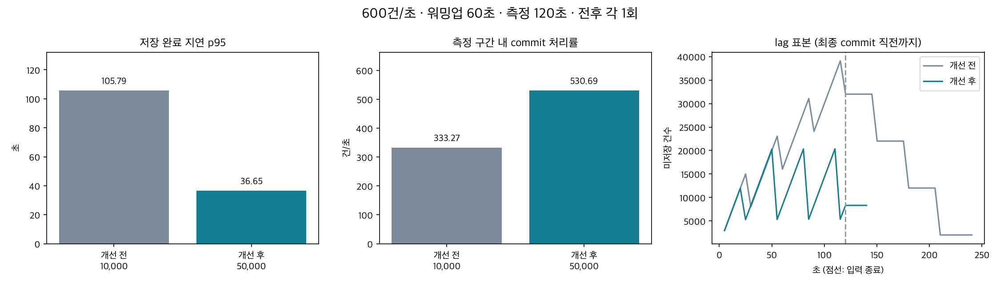

# 7주차 — B. 병목 개선과 동일 조건 검증

**배치당 읽기 상한을 10,000→50,000으로 변경한 뒤, 같은 600건/초 입력에서 측정 구간 내 저장 완료율은 333.27→530.69건/초, 지연 p95는 105.79→36.65초로 관측됐습니다.** 전후 각 1회 측정 결과이며 최대 처리량을 뜻하지 않습니다.

측정일: 2026-11-08. 6회차 자료 8쪽의 B안과 7회차 자료 3~4·6쪽의 실험 기준을 적용했습니다. API 연동은 선택하지 않았습니다.



## 1. 6주차에서 찾은 문제와 사전 가설

위키피디아 편집을 Kafka로 받아 Spark로 정제하고 S3에 보관하는 파이프라인입니다. [6주차](week6.md)에서는 100·300건/초의 p95가 약 36초였지만, 600건/초에서 약 104~105초로 증가했습니다. S3 Parquet 쓰기는 평균 6.077초로 내부 작업의 약 92%였지만, 전체 배치 실행은 평균 8.396초로 trigger 간격 30초보다 짧았습니다.

따라서 우선 바꿀 것은 저장 방식보다 **30초에 최대 10,000건만 읽는 상한**이었습니다. 읽기 상한은 약 `10,000 ÷ 30 = 333건/초`이므로 600건/초가 들어오면 배치가 빨리 끝나도 밀린 데이터가 다음 trigger를 기다립니다.

[실행 전에 기록한 가설](../../evidence/week7/experiment-plan.md): 상한을 50,000으로 올려도 배치가 30초 안에 끝난다면 백로그 누적이 줄고 **p95가 60초 미만**이 될 것으로 예상했습니다. 설정상 읽기 상한은 1,667건/초가 되지만 이는 처리 능력 측정값이 아닙니다. 상한 5배 증가를 전체 성능 5배 향상으로 해석하지 않습니다.

## 2. 바꾼 것은 읽기 상한 하나

`maxOffsetsPerTrigger`를 10,000→50,000으로 변경했습니다. 같은 30초 동안 들어오는 약 18,000건을 여러 trigger로 나누어 기다리는 대신 한 배치에서 읽을 수 있게 하는 변경입니다. 코어·메모리·파티션·trigger·캐시·S3 저장 방식은 그대로 유지했습니다.

```python
.option('maxOffsetsPerTrigger', int(os.getenv('WIKI_MAX_OFFSETS', '50000')))
```

비교 완료 후 기본값도 50,000으로 반영하고 Airflow 컨테이너에서 Spark로 같은 환경 변수를 전달하도록 했습니다. 10,000으로 되돌리려면 `.env.local`의 `WIKI_MAX_OFFSETS=10000`으로 설정한 뒤 운영 컨테이너를 다시 생성합니다. 현재 실행 중인 운영 서비스에는 재시작을 가하지 않았습니다.

## 3. 같은 조건으로 다시 측정

| 조건 | 개선 전·후 공통 |
|---|---|
| 목표 입력 | 600건/초 |
| 워밍업 | 100건/초 × 60초, 완료까지 drain |
| 측정 | 120초 × 1회, 입력 종료 뒤 전량 drain |
| 입력·저장 | 각 78,000건: 준비 6,000 + 측정 72,000 |
| 데이터 | 같은 합성 이벤트 생성기·payload 분포; 실행 ID와 발생 시각만 새로 생성 |
| Spark | local[2], driver 1g, 컨테이너 2g, shuffle 2 |
| Kafka | 3파티션, 컨테이너 1g, 매 실험 별도 토픽 |
| trigger / 저장 | 30초 / 실제 AWS S3 |
| Docker | 10 CPU, 메모리 7.65 GiB |
| 격리 | 전후 새 체크포인트·S3 prefix, 운영 데이터 미사용 |

다른 Kubernetes 컨테이너는 실행 중이었고 중지하지 않았습니다. 두 실행의 이미지 ID와 주요 환경·파라미터가 같은지 비교 스크립트로 확인했습니다. 전후 실행 시작은 각각 19:40·21:26 KST로 약 1시간 46분 차이가 났으며, 개선 후에는 Kubernetes의 Airflow migration 대기 컨테이너 2개도 환경 목록에 있었습니다. 워크로드·주요 리소스 설정은 같지만 전체 호스트 상태까지 통제한 실험은 아닙니다. 호스트 부하나 S3 응답 변동의 영향이 남으므로 관측 개선율을 단일 변경의 순수 효과로 확정하지 않습니다.

| 지표 | 개선 전 (10,000) | 개선 후 (50,000) |
|---|---:|---:|
| 실제 ACK 입력률 | 600.00건/초 | 600.01건/초 |
| 측정 구간 내 commit 처리률 | 333.27건/초 | 530.69건/초 |
| 지연 p50 | 61.13초 | 22.97초 |
| 지연 p95 | 105.79초 | 36.65초 |
| 입력 중 최대 lag | 39,105건 | 20,364건 |
| 입력 중 lag 선형 추세 | 280.42건/초 | 58.60건/초 |
| 기록된 Spark 배치 실행 평균 | 9.418초 | 8.694초 |
| 측정·drain 배치 평균 행 수 | 9000.0 | 14400.0 |
| 원시 저장 / 고유 Kafka offset | 78,000 / 78,000 | 78,000 / 78,000 |
| 정상 ID 누락 / 예상 밖 ID / offset 중복 | 0 / 0 / 0 | 0 / 0 / 0 |

처리률은 **입력 중인 120초 안에 commit된 건수 ÷ 120초**입니다. 마지막 배치가 입력 종료 후 완료되면 이 값은 입력률보다 낮게 나옵니다. Spark의 `processedRowsPerSecond`처럼 실제 작업 시간만 나눈 값이나 지속 가능한 최대 처리량과 다릅니다. p95는 측정 이벤트가 생성된 시각부터 S3 commit까지이며 drain 중 완료된 이벤트도 포함합니다. lag는 Kafka end offset과 S3 commit offset의 차이입니다. 그래프는 5초 간격 실측 표본이며, 마지막 commit 직전에 수집이 종료되어 끝점이 0이 아닙니다. 최종 미저장 0건은 그래프 끝점이 아니라 전체 입력·저장 대조로 확인했습니다.

가설의 p95 60초 미만 기준은 **충족**했습니다. 관측 p95 감소율은 65.4%입니다. 다만 반복 실험에 따른 신뢰구간은 없으며, 운영 Airflow의 10분 예약 대기까지 줄였다는 의미는 아닙니다.

## 4. 개선 후 시간을 다시 나눠 본 결과

| 배치 내부 구간 | 개선 전 평균 (내부 합 대비 비중) | 개선 후 평균 (내부 합 대비 비중) |
|---|---:|---:|
| 변환·건수 확인 | 0.418초 (5.5%) | 0.606초 (8.5%) |
| S3 Parquet 쓰기 | 7.001초 (91.8%) | 6.254초 (88.1%) |
| 날짜·offset 계산 | 0.115초 (1.5%) | 0.144초 (2.0%) |
| 완료 기록 쓰기 | 0.089초 (1.2%) | 0.097초 (1.4%) |

워밍업을 제외하고 측정 입력과 drain 배치를 집계했습니다. 내부 시간은 개선 전 8개·후 5개 배치에서 기록했습니다. Spark progress는 개선 전 8개·후 4개만 남아 개선 후 마지막 drain 배치 1개가 빠졌습니다. 따라서 위 Spark 실행 시간 평균은 기록된 배치에 한정하며, 지연·저장 건수 검증에는 마지막 배치도 포함됩니다. 내부 구간 합과 Spark의 전체 `triggerExecution`은 측정 범위가 겹치므로 합산하지 않습니다.

개선은 배치 자체를 무조건 빨리 만드는 방식이 아니라, **한 번에 읽는 양을 늘려 trigger 사이의 백로그 대기를 줄이는 방식**입니다. 다음 최적화 후보는 내부 시간 중 88.1%를 차지하는 S3 Parquet 쓰기입니다. 이 구간이 현재 입력률에서 실제 처리 한계를 만든다고 확정한 것은 아닙니다.

내부 S3 쓰기만 2배 빨라진다고 가정하면 내부 처리 시간의 이론적 속도 향상은 `1 / (1 - 0.881 + 0.881/2)` ≈ 1.79배입니다. 이는 가정 계산이며 전체 지연·처리량의 실측 개선율이 아닙니다. 두 번째 병목 개선은 보너스 범위라 이번에는 실행하지 않았습니다.

## 5. 재현과 증빙

```bash
# 프로젝트 루트, 테스트 의존성이 설치된 Python 환경에서 순서대로 실행
python tests/performance/week6_run.py --rates 600 --warmup 60 --seconds 120 --repetitions 1 --max-offsets 10000 --skip-faults
python tests/performance/week6_run.py --rates 600 --warmup 60 --seconds 120 --repetitions 1 --max-offsets 50000 --skip-faults
python tests/performance/week7_compare.py artifacts/week6/20261108T104012Z artifacts/week6/20261108T122611Z --output evidence/week7/comparison.json
```

비교 명령의 run ID는 이번 실행 값입니다. 다시 실행할 때는 새로 출력된 ID로 바꿉니다. AWS CLI의 기존 인증으로 버킷 접근을 확인한 후 같은 프로필을 쓰는 Spark/S3 검증을 실행했습니다.

- [비교 결과·실행 환경·배치 원본 수치](../../evidence/week7/comparison.json)
- [상세 로그 S3 보관·복원](../../evidence/week7/README.md)
- [6주차 결과 표와 개선 후 행](week6.md)

이전 60초 간이 결과(p95 36.94초)는 측정 조건이 달라 이번 비교에서 제외했습니다. 기존 증빙은 보존합니다. 6주차의 장애·재처리·실제 Discord 자동 알림 검증도 그대로 유지하며, 이번 성능 비교에서 다시 실행하지 않았습니다.
